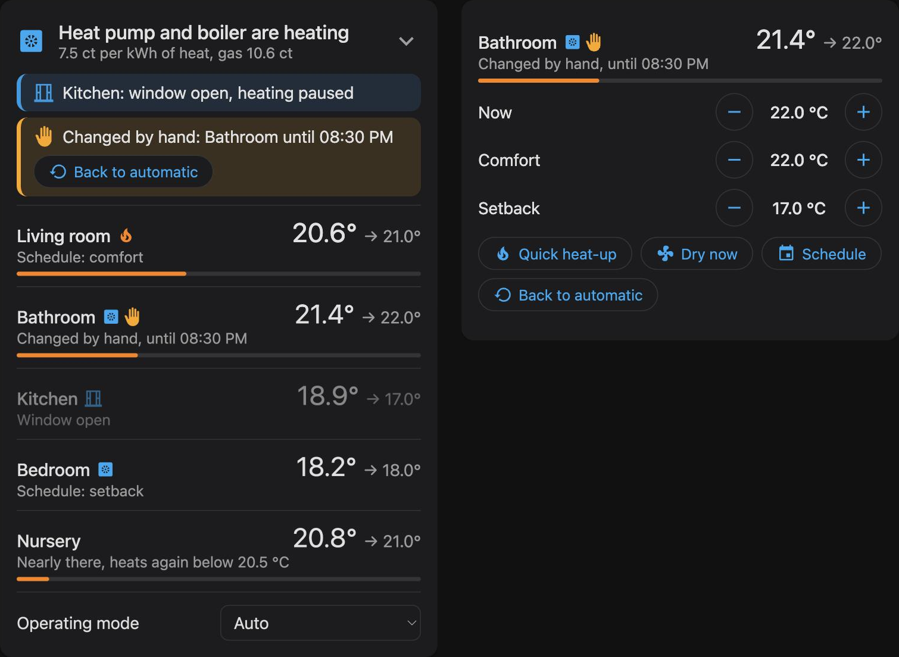

<p align="center"></p>

# Thriftherm for Home Assistant

**English** | [Deutsch](README.md)

[](https://hacs.xyz)
[](https://github.com/alpha-uniform/thriftherm/releases)
[](https://buymeacoffee.com/alphauniform)

**Demand-based heating for Home Assistant.** Thriftherm heats every room to its schedule and gives your gas boiler the controller it previously lacked. It also works with district heating, and a heat pump can join in: an air conditioner in heating mode such as the **Midea PortaSplit**, which Thriftherm controls and whose COP it measures.

<p align="center"></p>

## What Thriftherm does for you

**Own gas boiler on ebusd: the core.** Thriftherm becomes your boiler's controller and talks to it through [ebusd](https://ebusd.eu). It keeps the flow temperature as low as possible, blocks heating when no room needs heat, and learns for every room how much flow it needs.

**Plus a heat pump.** Thriftherm measures its COP and lets it heat when its heat is cheaper than the boiler's right now. Without sensors at the unit, a Midea PortaSplit can use values measured on a PortaSplit. It dries a bathroom it heats after a shower.

**District heating, central heating or no own boiler.** Thriftherm heats the rooms to their schedules through their radiator valves, directly or through [Better Thermostat](https://github.com/KartoffelToby/better_thermostat), with pre-heating and away mode; nothing is ever sent to the heat supply. It really pays off with a heat pump: Thriftherm then compares electricity with the marginal price of district heat. Without a boiler, the heat pump can also heat on its own.

To start, one temperature sensor or one smart valve per room is enough. Thriftherm drives smart valves directly (preview, Sonoff TRVZB/TRVZBT in use since 2026-11-15) or through Better Thermostat; both can be added later, room by room. What exactly works with which equipment is in the [overview in the setup guide](en/SETUP.md#what-works-with-your-equipment).

**Everything stays with you.** Thriftherm runs entirely locally in Home Assistant and sends no data anywhere: no cloud, no account, no usage statistics. The dashboard card loads nothing from the internet either.

## What changes at the boiler

Many boilers run without a real controller. The boiler then keeps its heating circuit at the knob temperature all winter, even when every thermostatic valve is closed. It fires for a few seconds at minimum load, overshoots and cycles. A typical case is a central room controller on the eBUS: it measures a single room, decided for the whole flat from it and was not connected to the internet. Thriftherm takes over the controller's job:

- **Flow temperature as low as possible:** from the heating curve, the heat demand of the rooms and the spread between flow and return. The room that needs the most sets the flow.
- **Heating blocked when no room needs heat.** Hot water is not touched and keeps following the knob.
- **Heat-up speed of your choice** in °C per hour. More speed burns more gas.
- **Hot water recognised:** after a shower learning pauses for an hour, so shower water does not upset the heating curve.
- **Heating off over eBUS** (mode *Off (frost protection only)*): heating is off, hot water keeps working, and the knob can stay open.
- **Safe fallback:** if Home Assistant stops, the boiler returns to its own knob after 9 to 16 minutes. The knob always remains the upper limit.

Every decision comes with a reason you can read in Home Assistant. When boiler data is missing, Thriftherm sends nothing and the boiler runs on its knob.

## How long Thriftherm learns

From the first day Thriftherm heats with starting values: your heating curve, a typical heat-up rate and a COP curve from the data sheet. What it learns on top comes only from real heating runs and with *Active*:

- **Heating curve per room:** first corrections on the first heating day, stable after about 1 to 2 weeks of heating season. It learns the slope for cold days only in frost.
- **Heat-up rates:** a value of its own after 2 to 4 days with a setback, a reliable one after 1 to 2 weeks.
- **COP map of the heat pump:** the frequent outdoor temperatures after 2 to 4 weeks, frost only in frost.

The times are estimated from the rules and depend on the weather ([details](en/GUIDE.md#how-long-learning-takes)).

## Quick start

Nothing is written to the boiler or the thermostats until you switch to *Active* yourself.

1. **ebusd:** connect the eBUS adapter to the boiler's eBUS terminal (a room controller already there is disconnected), then set up the ebusd app with MQTT, with `--accesslevel=*` and the `filter-name` addition ([step 2](en/SETUP.md#2-set-up-ebusd)); skip this without an own boiler.
2. **Install:** search for **Thriftherm** in HACS, download it and restart Home Assistant. This button is quicker, it opens Thriftherm in HACS directly:

   [](https://my.home-assistant.io/redirect/hacs_repository/?owner=alpha-uniform&repository=thriftherm&category=integration)

3. **Add the integration:** *Settings → Devices & services → Add integration → Thriftherm*. When ebusd entities are found, the boiler step is filled in for you – check it and continue.
4. **Observe only for a few days** (Thriftherm works out and shows what it would do, but controls nothing)**:** compare *Boiler command*, *Thermostat plan* and *Decision reason* with what you would have done.
5. **Switch to *Active*:** release active control in the options, then set *Boiler control* and *Room control* to *Active*.
6. **Card on the dashboard:** *Add card → Thriftherm*. It comes with the integration and finds your rooms by itself ([step 9](en/SETUP.md#9-dashboard)).

## Documentation

- [Setup](en/SETUP.md): step by step from nothing to *Active*
- [User guide](en/GUIDE.md): daily use with modes, temperatures, thermostats, learning and how long it takes, services, repairs and a list of terms
- [How it works](en/HOW_IT_WORKS.md): how Thriftherm decides, with thresholds, learning steps and rules
- [Troubleshooting](en/TROUBLESHOOTING.md): when something does not work, ordered by what you see
- [Poll fewer ebusd values](en/EBUSD.md): optional, for fresher flow and return values
- [Changelog](en/CHANGELOG.md): what each version brings

**Languages:** Thriftherm speaks German or English, following Home Assistant's language. More in the [user guide](en/GUIDE.md).

## Verified on real hardware

Tested on a Vaillant atmoTEC plus VCW 194/4-5 (non-condensing combi boiler, ebusd circuit `bai`, definition `bai.308523`) with an eBUS adapter C6:

| Finding | Result |
|---------|--------|
| `SetMode` from ebusd (address 31) accepted | yes, external setpoint d.09 follows the value |
| Effective flow setpoint | `min(front knob, eBUS setpoint)` – the knob is the upper limit |
| Heating block `disablehc=1` | space heating blocked, **hot water unaffected** |
| Hot water setpoint sent as `-` (no value) | accepted; the heating setpoint still applies and hot water keeps following the knob |
| Fallback without new `SetMode` | back to the knob after 9–16 min |
| Knob at the left stop | summer mode (d.23 off), blocks heating regardless of eBUS |
| Without a controller, valves closed | 30 s burner runs, overshoot by 14 degrees, then anti-cycling – the waste this integration removes |
| Pump mode "post-run" (d.18 = 0, factory) | pump runs only with the burner; the water circles through the bypass and **the last radiator stays cold** |
| Pump mode "permanent" (d.18 = 1) | pump runs while heating is released and **stops when `disablehc=1`**; ~33 W; the cold radiator warmed within an hour |
| Minimum flow on this non-condensing boiler | 30 °C left the last radiator cold, 45 °C works |
| ebusd `Status01` "pump state" | follows the heating demand, not the pump; the pump itself is `WP`, the display code `Statenumber` |

## Hardware used

This is what Thriftherm is developed on. Other devices work the same way as long as they show up in Home Assistant.

| Job | Device |
|---|---|
| Boiler | Vaillant atmoTEC plus VCW 194/4-5 (non-condensing) |
| eBUS adapter | [eBUS Adapter Shield C6](https://adapter.ebusd.eu/v5-c6/index.en.html), stick version, by ebusd.eu – sold in the [Elecrow shop](https://www.elecrow.com/store/ebusd) |
| Gas meter reading | [WiFi ACM-ESP](https://www.seegel-systeme.de/produkt/wlan-acm-esp-kommunikationsmodul-fuer-elster-gaszaehler/) by Seegel Systeme, for Elster/Honeywell BK-G4A(T) |
| Radiator thermostats | [SONOFF TRV Gen2 (TRV-ZBT)](https://sonoff.tech/en-us/products/sonoff-trv-gen2-zigbee-thermostatic-radiator-valve-trv-zbt), Zigbee2MQTT, driven directly (up to 0.7 with Better Thermostat) |

## Supported boilers

| Boiler | ebusd circuit / definition | Status | Data from |
|--------|----------------------------|--------|-----------|
| Vaillant atmoTEC plus VCW 194/4-5 | `bai` / `bai.308523` | verified, write test passed | maintainer |
| Vaillant atmoTEC pro VUW PL 240/3-3M | `bai` / `bai.308523` | verified by its owner, write test passed, back to the knob after about 15 min | [jwarzecha](https://github.com/jwarzecha) ([#4](https://github.com/alpha-uniform/thriftherm/issues/4)) |
| Vaillant ecoTEC plus VCW AT 196/5-5 R2 | `bai` / `bai.<article-no>` | reads over ebusd (with an eBUS Adapter Shield C6), active control since November 2026, feedback on writing still open | a user in the simon42 forum |
| Vaillant VCW DE 244/4-5-HL R1 (2011, part load limited to 10 kW) | still open | checked in operation with an eBUS Adapter Shield C5: block and release are taken (the burner starts a minute after the release) | [elektroduell](https://github.com/elektroduell) ([#7](https://github.com/alpha-uniform/thriftherm/issues/7)) |

Each boiler is added as a profile: which ebusd messages carry its values and which message takes the setpoint. I can only test the boiler in my own home. Every other boiler is added from data its owners share, so **your boiler can be next**: open a [boiler data issue](https://github.com/alpha-uniform/thriftherm/issues/new?template=boiler_data.yml) with the model, the ebusd definition and what you observed. Whoever contributes data is credited in the table above if they wish; without a name the entry stays anonymous.

## Requirements

- Home Assistant 2026.9 or newer
- With an own boiler: an eBUS adapter and the ebusd app with MQTT
- Per room a temperature sensor, a smart valve or a thermostat (something has to measure the room); Better Thermostat is no longer needed
- Optional: a heat pump with a few sensors

The full list is in the [setup guide, step 1](en/SETUP.md#1-what-you-need).

## Status and responsibility

**Writing to a gas boiler is your responsibility.** Over ebusd only the `SetMode` message is used and no installer parameters are written; with a boiler through entities (preview) only the two entities you choose. Changing the pump mode is a one-time decision you make yourself.

**What has been tried.** All controllers start in *Observe only*: they compute and publish what they would do and write nothing until you release active control. Blocking, flow control and the safety fallbacks are verified on the maintainer's boiler. The learned corrections have so far seen outdoor temperatures down to 2 °C, no frost yet. The heat pump add-on controls the maintainer's Midea PortaSplit, icing and defrosting included; other units have not been tried yet.

## Development

```bash
python3 -m venv .venv
./.venv/bin/pip install pytest pytest-asyncio pytest-homeassistant-custom-component pytest-xdist
./.venv/bin/pytest -q -n auto
```

The engines under `custom_components/thriftherm/engines/` are pure Python without Home Assistant imports and unit-tested (about 90 % line and branch coverage).

## ☕ Support

Thriftherm is built in my spare time. If it saves you energy or money, you can [buy me a coffee](https://buymeacoffee.com/alphauniform) – it gives me back a bit of the time that goes into new features and new boilers.

<a href="https://buymeacoffee.com/alphauniform"></a>

**Heating Heroes** are listed here:

- **David** – the first coffee, and two ideas that are in now: counting the gas for heating and for hot water apart, without a gas meter too, and trimming the list ebusd polls so that the values that matter come more often. Thank you!
- **[jwarzecha](https://github.com/jwarzecha)** – a coffee, the idea that the boiler comes only when the thermostat wants to heat too ([#3](https://github.com/alpha-uniform/thriftherm/issues/3)), and the data of a Vaillant atmoTEC pro ([#4](https://github.com/alpha-uniform/thriftherm/issues/4)). Thank you!
- **[elektroduell](https://github.com/elektroduell)** – coffees, the data of his Vaillant VCW with an eBUS Adapter Shield C5, and the Shelly sensors that report only on a change: they brought the switch *Room sensors report only on a change* ([#7](https://github.com/alpha-uniform/thriftherm/issues/7)) and a heating curve learning that no longer misreads such sensors. Thank you!

## License

MIT
