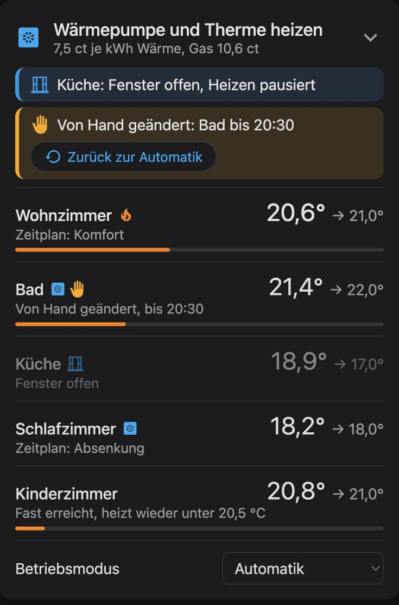
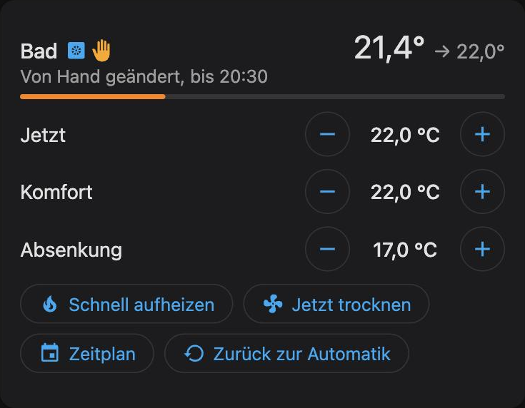

# Thriftherm einrichten

[English](../en/SETUP.md) | **Deutsch**

Diese Anleitung bringt dich Schritt für Schritt von null zu einer laufenden Thriftherm-Installation. Du musst dich weder mit ebusd noch mit den Innereien von Home Assistant auskennen, und du liest nur die Schritte, die zu deiner Heizung passen.

**An Therme und Thermostate geht nichts, bis du in Schritt 7 selbst auf *Aktiv* stellst.** Bis dahin rechnet Thriftherm nur und zeigt an, was es tun würde – du kannst also jeden Schritt gefahrlos ausprobieren.

## Dein Weg

Die erste Frage im Einrichtungsdialog ist „Was für eine Heizung hast du?“. Danach richtet sich, welche Schritte du brauchst:

| Deine Heizung | Im Dialog wählen | Deine Schritte |
|---|---|---|
| Gastherme mit eBUS (Vaillant, Saunier Duval, Wolf und andere eBUS-Thermen) | *Eigene Gas- oder Ölheizung* | 1, 2, 3, 4, 5, 6, 7, 9 |
| Therme ohne eBUS, über OpenTherm oder zwei Entitäten (Vorschau) | *Eigene Gas- oder Ölheizung*, dann [4.3a](#43a-therme-ohne-ebusd-über-entitäten-vorschau) | 1, 3, 4, 5, 7, 9 |
| Fernwärme, Zentralheizung, Wärme vom Vermieter | *Zentralheizung, Fernwärme oder Wärme vom Vermieter* | 1, 3, 4, 5, 7, 9 |
| Nur eine Wärmepumpe oder ein Klimagerät, keine Therme | *Keine – nur Wärmepumpe und Raumsteuerung* | 1, 3, 4, 5, 7, 9 |

Für jeden Raum wählst du in Schritt 5, wie Thriftherm ihn steuert: Ventile direkt, Better Thermostat, Versatile Thermostat oder nur mit einem Fühler. Der Dialog lässt Schritte, die nicht passen, von selbst weg.

| Schritt | Was du tust | Wo |
|---|---|---|
| [1](#1-was-du-brauchst) | Prüfen, ob alles da ist | – |
| [2](#2-ebusd-einrichten) | Home Assistant mit der Therme verbinden | ebusd-App |
| [3](#3-thriftherm-installieren) | Thriftherm installieren | HACS (Marketplace) |
| [4](#4-integration-hinzufügen) | Den Einrichtungsdialog durchgehen | Home Assistant |
| [5](#5-ventile-oder-thermostate-je-raum-optional) | Ventile direkt oder ein Thermostat je Raum | Home Assistant, Better Thermostat |
| [6](#6-an-der-therme) | Drehknopf stellen, Pumpenmodus prüfen | an der Therme |
| [7](#7-erst-nur-beobachten-dann-aktiv) | Ein paar Tage beobachten, dann aktiv schalten | Home Assistant |
| [8](#8-wenn-etwas-nicht-klappt) | Wenn etwas nicht klappt | – |
| [9](#9-dashboard) | Die Thriftherm-Karte aufs Dashboard legen | Home Assistant |

## 1. Was du brauchst

**Für alle:**

| Was | Nötig? | Hinweis |
|---|---|---|
| Home Assistant 2026.9 oder neuer | ja | *Einstellungen → Über* zeigt deine Version. Temperaturen in °C (metrisches Einheitensystem): Thriftherm rechnet nur in °C und bricht die Einrichtung sonst ab; später umgestellt, sendet es keine Sollwerte mehr (eine laufende Wärmepumpe wird gestoppt, eine Therme über Entitäten zurückgegeben) und zeigt eine Reparaturmeldung |
| Ein Temperaturfühler je Raum | empfohlen | jeder Sensor, der in Home Assistant die Raumtemperatur zeigt. Ohne ihn misst das Ventil oder Thermostat am Heizkörper, ungenauer. Etwas muss den Raum messen; die Bad-Trocknung braucht den Fühler |
| Fensterkontakte | optional | solange ein Fenster offen ist, pausiert das Heizen in diesem Raum |
| Feuchtesensoren | optional | Schutz gegen Feuchte, während du weg bist |
| Smarte Heizkörperventile | optional | damit Thriftherm die Raumtemperaturen vorgibt: direkt gesteuert (Vorschau, ohne weitere Integration) oder über **Better Thermostat** bzw. Versatile Thermostat. Ohne sie funktioniert die Thermensteuerung trotzdem |
| Außentemperaturfühler | optional | sonst dient eine Wetter-Entität |

**Mit eigener Gastherme über eBUS zusätzlich:**

| Was | Nötig? | Hinweis |
|---|---|---|
| Therme mit eBUS | ja | für die Thermensteuerung |
| eBUS-Adapter | ja | zum Beispiel ein ebusd Adapter Shield, an die eBUS-Klemmen der Therme angeschlossen |
| MQTT-Broker | ja | die App **Mosquitto broker** |
| App **ebusd** | ja | liest die Therme und schickt ihr den Sollwert |
| Gaszähler-Werte | optional | Gesamtvolumen (m³ oder Liter) und Momentanfluss (m³/h oder L/min), falls dein Gaszähler in Home Assistant ist. Ein Sensor in einer anderen Einheit (etwa kWh) wird nicht gelesen |

Eine Therme ohne eBUS braucht stattdessen eine Zahl-Entität für den Vorlauf und einen Schalter für die Heizung, etwa von einem OpenTherm-Adapter ([4.3a](#43a-therme-ohne-ebusd-über-entitäten-vorschau)); auch ein Gaszähler geht dort.

**Ein zentraler Raumregler an der eBUS-Klemme muss weichen.** Hängt an der eBUS-Klemme deiner Therme schon ein Raumregler, klemmst du ihn ab; an dieselbe Klemme kommt der eBUS-Adapter. Thriftherm übernimmt die Aufgabe des Reglers, und zwei Regler am eBUS würden sich gegenseitig die Vorgaben überschreiben.

**Mit Wärmepumpe:** Die **Wärmepumpen**-Erweiterung steuert eine Klimaanlage im Heizbetrieb, erprobt an einer Midea PortaSplit. Du kannst sie ganz weglassen. Willst du sie nutzen, braucht sie die Climate-Entität der Wärmepumpe, einen Zwischenstecker, der ihre Leistung misst, Temperatur und Feuchte ihrer Ansaugluft und die Temperatur ihrer Ausblasluft.

### Was mit deiner Ausstattung geht

Im ersten Einrichtungsschritt wählst du, welche Heizung du hast. Schritte, die nicht passen, lässt der Dialog weg. Die Tabelle zeigt, was Thriftherm dann für dich tut.

| Funktion | Eigene Therme über ebusd (Kern) | + smarte Ventile | + Wärmepumpe | Nur Wärmepumpe, keine Therme | Zentral- oder Fernwärme¹ |
|---|:-:|:-:|:-:|:-:|:-:|
| **Räume** | | | | | |
| Solltemperaturen aus Zeitplänen (Komfort, Absenkung, Zeitplan-Helfer) | ✓ | ✓ | ✓ | ✓ | ✓ |
| Vorheizen, damit der Raum zu Beginn des Zeitplans warm ist | ✓ | ✓ | ✓ | ✓ | ✓ |
| Abwesenheit mit Vorheizen zur Rückkehr | ✓ | ✓ | ✓ | ✓ | ✓ |
| Solltemperatur eines Raums vorübergehend übersteuern | ✓ | ✓ | ✓ | ✓ | ✓ |
| Fenster offen: Der Raum fordert keine Wärme mehr an | ✓ | ✓ | ✓ | ✓ | ✓ |
| Gelernte Aufheiz- und Abkühlrate je Raum | ✓ | ✓ | ✓ | ✓ | ✓ |
| Sollwerte an die Thermostate; Drehen von Hand wird zur vorübergehenden Übersteuerung | – | ✓ | ✓ | – | ✓ |
| Knopf „Schnell aufheizen“ je Raum | – | ✓ | ✓ | ✓ | ✓ |
| Frostschutz, auch im Modus *Aus* | ✓ | ✓ | ✓ | ✓ | ✓ |
| **Therme** | | | | | |
| Vorlauf aus Heizkurve, Wärmebedarf der Räume und Spreizung Vorlauf/Rücklauf | ✓ | ✓ | ✓ | – | – |
| Heizbetrieb gesperrt, wenn kein Raum Wärme braucht; Warmwasser unberührt | ✓ | ✓ | ✓ | – | – |
| Gelernte Korrektur der Heizkurve je Raum: Der Raum, der am meisten braucht, bestimmt den Vorlauf | ✓ | ✓ | ✓ | – | – |
| Aufheiztempo nach Wunsch: mehr Vorlauf für einen Raum, der zu langsam warm wird, gelernt je Raum | ✓ | ✓ | ✓ | – | – |
| Warmwasser-Erkennung: Das Lernen pausiert nach dem Duschen | ✓ | ✓ | ✓ | – | – |
| Heizung aus über eBUS (Modus *Aus (nur Frostschutz)*), Warmwasser läuft weiter | ✓ | ✓ | ✓ | – | – |
| Rückfall auf den Drehknopf der Therme, wenn Home Assistant ausfällt | ✓ | ✓ | ✓ | – | – |
| **Wärmepumpe** | | | | | |
| Steuerung der Wärmepumpe: langsam mit hohem COP, volle Leistung bei „Schnell aufheizen“ | – | – | ✓ | ✓ | ✓² |
| COP aus Luftmenge und Enthalpie der Luft; Erkennung von Abtauen und Vereisung | – | – | ✓ | ✓ | ✓² |
| Kostenvergleich mit der zentralen Wärmequelle | – | – | ✓ | – | ✓² |
| Bad-Trocknung | – | – | ✓ | ✓ | ✓² |
| **Immer** | | | | | |
| Erst *Nur beobachten* (Thriftherm rechnet und zeigt, was es tun würde, steuert aber nichts), *Aktiv* erst nach deiner Freigabe; ein Grund für jede Entscheidung; Reparaturmeldungen | ✓ | ✓ | ✓ | ✓ | ✓ |

✓ geht · – nicht verfügbar. Jede „+“-Spalte enthält die Spalten links davon. In der Spalte „Nur Wärmepumpe“ gelten die Raum-Zeilen für die Räume, die die Wärmepumpe erreicht.

¹ Zentralheizung, Fernwärme oder Wärme vom Vermieter: keine eigene Therme. Die Räume steuert Thriftherm über ihre Ventile (direkt oder über Better Thermostat), an die Wärmeversorgung wird nie etwas geschrieben.

² Mit der Wärmepumpen-Erweiterung. Der Kostenvergleich rechnet dann mit dem Grenzpreis der Fernwärme, siehe [Bei Fernwärme](#bei-fernwärme).

**Gut zu wissen:**

- **Eine Wärmepumpe ohne Therme funktioniert.** Im ersten Einrichtungsschritt *Keine – nur Wärmepumpe und Raumsteuerung* wählen.
- **Bad-Trocknung braucht die Wärmepumpe.** Sie trocknet mit der warmen Luft der Wärmepumpe, nur in einem Raum, den die Wärmepumpe beheizt. Einzelheiten stehen in der [Anleitung, Wärmepumpe](ANLEITUNG.md#wärmepumpe-optional).
- **Alles in den Therme-Zeilen braucht eine eigene Therme über ebusd**, oder als Vorschau eine Therme über zwei Entitäten wie bei OpenTherm ([Schritt 4.3a](#43a-therme-ohne-ebusd-über-entitäten-vorschau)). Das betrifft Vorlauf, Heizsperre, gelernte Heizkurve, Warmwasser-Erkennung, Heizung aus über eBUS und den Rückfall auf den Drehknopf (den gibt es nur über ebusd, siehe 4.3a). Bei Fernwärme oder ohne Therme wird nie etwas über eBUS gesendet.

### Bei Fernwärme

Bei Fernwärme bringt Thriftherm vor allem mit einer Wärmepumpe etwas. Dann entscheidet es laufend, ob Wärme aus Strom oder aus der Fernwärme gerade günstiger ist, und lässt die Wärmepumpe nur heizen, wenn sie sich rechnet. Ausgenommen sind „Schnell aufheizen“, Bad-Trocknung und Lernläufe. Ohne Wärmepumpe bleibt nur die Raumsteuerung: Thriftherm gibt den Ventilen (direkt oder über Better Thermostat) Zeitpläne mit Vorheizen und die Abwesenheit. Viel mehr, als Better Thermostat mit einem Zeitplan schon kann, ist das nicht.

Der Kostenvergleich rechnet mit dem **Grenzpreis** der Wärme, nicht mit dem Preis, der auf der Rechnung steht. Nach der Heizkostenverordnung folgt nur der Verbrauchsanteil der Gebäudeabrechnung deinem eigenen Zähler, und vom Flächenanteil trägt deine Wohnung ihren Miteigentumsanteil. Eine gesparte kWh spart deshalb weniger, als der Preis je kWh vermuten lässt. Das *erhöht* den COP, den die Wärmepumpe erreichen muss. Beide Anteile stellst du bei den Preisen ein ([Schritt 4.2](#42-preise)); wer sie ignoriert, rechnet die Wärmepumpe schön.

## 2. ebusd einrichten

Nur für eine Gastherme mit eBUS. Alle anderen machen bei [Schritt 3](#3-thriftherm-installieren) weiter.

### 2.1 MQTT-Broker installieren

1. *Einstellungen → Apps* öffnen und **Mosquitto broker** installieren. Starten.
2. Home Assistant bietet danach unter *Einstellungen → Geräte & Dienste* die Integration **MQTT** an. Auf *Konfigurieren* klicken und bestätigen.

**Prüfen:** *Einstellungen → Geräte & Dienste* zeigt **MQTT**.

### 2.2 ebusd-App installieren

1. In *Einstellungen → Apps* den App Store öffnen, dann ⋮ → *Repositories* und `https://github.com/LukasGrebe/ha-addons` hinzufügen.
2. **ebusd** installieren. Noch nicht starten.

### 2.3 ebusd-App konfigurieren

Den Reiter **Konfiguration** der ebusd-App öffnen:

| Einstellung | Was du einträgst |
|---|---|
| Adapter / Gerät | deinen eBUS-Adapter: das USB-Gerät, oder bei einem Netzwerk-Adapter seine Adresse, zum Beispiel `ens:192.0.2.10:9999` |
| Kommandozeilen-Optionen | `--accesslevel=*` ergänzen – nötig, damit Thriftherm der Therme ihren Sollwert schicken kann. Zusätzlich kannst du `--mqttretain` setzen: Dann bleiben alle Werte im Broker liegen und stehen nach einem Neustart von Home Assistant sofort wieder da – auch veraltete, siehe den Hinweis unten |
| MQTT | nichts einzutragen: Die App findet den Mosquitto broker von Home Assistant selbst. Einen anderen Broker gibst du in den Kommandozeilen-Optionen an (`--mqtthost=…`, `--mqttport=…`, `--mqttuser=…`, `--mqttpass=…`) |
| `mqtt-hassio.cfg` kopieren (`seed_mqtt_cfg`) | an – damit liegt eine bearbeitbare Kopie der MQTT-Konfiguration im Ordner der App |

Speichern und die App starten.

> **Feste Adressen vergeben.** Ein Netzwerk-Adapter braucht eine feste IP-Adresse. Lege im Router eine **DHCP-Reservierung** für den eBUS-Adapter an, ebenso für jedes andere Netzwerkgerät, von dem Thriftherm Werte bekommt, etwa einen WLAN-Gaszähler. Was sonst passiert: [Fehlersuche, Keine Daten von der Therme](FEHLERSUCHE.md#reparaturmeldung-keine-daten-von-der-therme).
>
> Ob ebusd die Therme wirklich erreicht, zeigt nur *ebusd Signal* (`binary_sensor.…_global_signal`). Fällt es länger als zehn Minuten aus, meldet Thriftherm das unter Einstellungen → Reparaturen (*Keine Daten von der Therme*). Wer eine Push-Nachricht möchte, legt dafür eine Automation auf dieses Signal an, zum Beispiel „5 Minuten aus“.

### 2.4 Heizungspumpe und Status-Nummer sichtbar machen

Von sich aus schickt ebusd die Heizungspumpe (`WP`) und die Status-Nummer der Therme (`Statenumber`) nicht an Home Assistant. Eine Zeile ändert das:

1. `mqtt-hassio.cfg` im Ordner der ebusd-App öffnen (unter `addon_configs`, der Ordner, der auf `_ebusd` endet), zum Beispiel mit der App *File editor* oder *Studio Code Server*.
2. Die Zeile suchen, die mit `filter-name` beginnt, und `|^wp$|statenumber` hinten an ihren Wert anhängen (der Filter ignoriert Groß- und Kleinschreibung). Beispiel:

   ```
   filter-name = ...bisheriger Wert...|^wp$|statenumber
   ```

3. Speichern und die **ebusd-App neu starten**.

**Prüfen:** Nach bis zu zehn Minuten zeigt *Einstellungen → Geräte & Dienste → MQTT* ein ebusd-Gerät für deine Therme (zum Beispiel *ebusd bai*) mit Entitäten wie **FlowTemp temp**, **ReturnTemp temp**, **WP** und **Statenumber**. `WP` und `Statenumber` erscheinen oft erst nach ein paar Abfragen.

Ist Thriftherm schon eingerichtet? Dann *Thriftherm → Konfigurieren → Gastherme und Gaszähler* öffnen: Die leeren Felder *Heizungspumpe läuft (ebusd WP, on/off)* und *Status-Nummer der Therme (ebusd Statenumber, S.xx)* sind mit den gefundenen Entitäten ausgefüllt. Prüfen und absenden.

### 2.5 Weniger Werte abfragen, damit Vorlauf und Rücklauf frischer sind

Optional, für Fortgeschrittene. ebusd fragt die Werte der Therme reihum ab; je kürzer seine Liste, desto öfter kommen Vorlauf und Rücklauf (Beispiel in [Weniger ebusd-Werte abfragen](EBUSD.md): 1 Minute 48 Sekunden statt 4 Minuten Pause). Für die Regelung brauchst du das nicht, Thriftherm holt sich seine Werte selbst; es hilft, wenn du sie zeitnah im Dashboard sehen willst. Was weg kann, was bleiben muss und wie du kürzt: [Weniger ebusd-Werte abfragen](EBUSD.md).

## 3. Thriftherm installieren

**Mit HACS (empfohlen):** Thriftherm steht seit dem 21.10.2026 in der Standardliste von HACS. Seit Home Assistant 2026.11 ist HACS eingebaut und heißt *Marketplace*; wo hier HACS steht, gilt dort *Marketplace*.

Am schnellsten mit diesem Knopf, er öffnet Thriftherm direkt in HACS; dann *Herunterladen* klicken und bei Punkt 3 der Liste unten weitermachen:

[](https://my.home-assistant.io/redirect/hacs_repository/?owner=alpha-uniform&repository=thriftherm&category=integration)

Oder von Hand:

1. **HACS** öffnen und nach **Thriftherm** suchen.
2. Öffnen und *Herunterladen* klicken.
3. Home Assistant neu starten (*Einstellungen → System → ⋮ → Home Assistant neu starten*).

Wer Thriftherm schon als benutzerdefiniertes Repository eingetragen hat, muss nichts ändern: Es ist dasselbe Repository, die Updates kommen weiter über HACS.

**Von Hand:** den Ordner `custom_components/thriftherm` aus dem Repository nach `config/custom_components/` deiner Home-Assistant-Installation kopieren, dann neu starten.

**Prüfen:** *Einstellungen → Geräte & Dienste → Integration hinzufügen* findet **Thriftherm**.

## 4. Integration hinzufügen

*Einstellungen → Geräte & Dienste → Integration hinzufügen* öffnen und **Thriftherm** wählen. Der Dialog hat bis zu sechs Schritte. Alles lässt sich später unter *Thriftherm → Konfigurieren* (den Optionen) ändern.

### 4.1 Was für eine Heizung hast du?

| Feld | Was du wählst |
|---|---|
| Art der Heizung | **Eigene Gas- oder Ölheizung** für die Thermensteuerung über ebusd. Bei *Zentralheizung, Fernwärme oder Wärme vom Vermieter* oder *Keine – nur Wärmepumpe und Raumsteuerung* entfällt der Thermen-Schritt |

Änderst du die Art später in den Optionen, folgen die Preise für die neue Art und bei eigener Therme der Thermen-Schritt; gespeichert wird erst nach dem letzten Schritt.

### 4.2 Preise

Die Werte stehen auf deinen Abrechnungen. Die vorausgefüllten Zahlen sind nur Beispiele.

| Feld | Wo du es findest |
|---|---|
| Strompreis | Stromrechnung, €/kWh |
| Gaspreis | Gasrechnung, €/kWh |
| Effektiver Wirkungsgrad der Therme (Hs) | im Zweifel den Standardwert lassen |
| Brennwert Hs | Gasrechnung, kWh/m³ |
| Zustandszahl (Z) | Gasrechnung |

Bei Fernwärme erscheinen stattdessen *Wärmepreis laut Abrechnung*, *Davon nach Verbrauch abgerechnet* und *Dein Miteigentumsanteil (MEA) am Haus*.

### 4.3 Gastherme (ebusd) und Gaszähler

Der Schritt *Gastherme (ebusd) und Gaszähler* sucht nach deiner ebusd-Therme und trägt ein, was er findet: die Werte der Therme, ihren ebusd-Kreis, das eBUS-Signal und, wenn genau einer passt, den Gaszähler. Die Beschreibung des Schritts sagt, was gefunden wurde, zum Beispiel *Gefunden: Vaillant (bai), 5 von 5 Werten – bitte prüfen.* Prüfe die Felder und mach weiter. Wurde nichts gefunden, steht dort *Keine Therme über ebusd gefunden – bitte wähle die Entitäten selbst aus.*

| Feld | Was du wählst oder einträgst |
|---|---|
| Vorlauftemperatur | ebusd **FlowTemp temp** |
| Rücklauftemperatur | ebusd **ReturnTemp temp** |
| Therme-Status aus Status01 (off/on/overrun/hwc) | ebusd **Status01 pumpstate** (Status01 liefert mehrere Entitäten; die anderen sind Temperaturen) |
| Heizungspumpe läuft (ebusd WP, on/off) | ebusd **WP** |
| Status-Nummer der Therme (ebusd Statenumber, S.xx) | ebusd **Statenumber** |
| Warmwasser läuft (Binärsensor, optional) | bei ebusd leer lassen: Warmwasser erkennt Thriftherm an Status01, Status-Nummer und Temperaturen. *Status02 hwcmode* ist die Betriebsart (an, aus, auto), nicht das laufende Warmwasser |
| eBUS-Signal (Binärsensor) | **das Signal von ebusd selbst** (`binary_sensor.…_global_signal`), nicht den Verbindungssensor des Adapters: Fällt der Adapter aus dem WLAN, bleibt sein eigener Sensor auf seinem letzten Wert „an“ stehen |
| Nenn-Umlaufwassermenge der Pumpe | den Standardwert lassen, außer die Anleitung deiner Therme sagt etwas anderes |
| Gaszähler Volumen (m³, Gesamt), Gaszähler Momentanfluss (m³/h) | deine Gaszähler-Entitäten, falls vorhanden; sonst leer lassen. Die Steuerung braucht keinen Gaszähler: Brennerlauf und Warmwasser erkennt sie an Pumpe und Statuscode. Ohne Zähler gibt es die Sensoren *Gasleistung* und *Gasenergie* nicht |
| Ohne Gaszähler: Nennwärmebelastung der Therme (Typenschild, kW) | nur ohne Gaszähler und nur bei einer Vaillant-Therme: der Wert **Q** oder **Qn** vom Typenschild, bei einem Bereich der größere (atmoTEC plus VCW 194/4-5: 22,2). Damit schätzt Thriftherm *Gas für Heizung* und *Gas für Warmwasser* aus den Zählern der Therme ([wie genau](ANLEITUNG.md#wichtige-anzeigen)). Dafür müssen die sechs ebusd-Nachrichten PrEnergySumHc1 bis 3 und PrEnergySumHwc1 bis 3 in Home Assistant ankommen, schließ sie also nicht aus ([Weniger ebusd-Werte abfragen](EBUSD.md#was-thriftherm-braucht)); Thriftherm findet sie selbst. Mit Gaszähler leer lassen |
| Leistung der Heizungspumpe (W, optional) | nur mit Wärmepumpe: Dann kommt der Strom der Heizungspumpe zum Preis der Thermenwärme dazu ([wie](ANLEITUNG.md#wärmepumpe-optional)). Eine Pumpe im Dauerbetrieb braucht oft 20 bis 50 W (Typenschild oder Zwischenstecker). Leer lassen, um nur das Gas zu vergleichen |
| Warmwasser bereithalten (Warmhalten der Kombitherme, Speicherladung) | eingeschaltet lassen. Ausschalten nur bei einer Kombitherme ohne Speicher, die dich nachts mit ihrem Warmhalten stört (etwa ein Brennerstart pro Stunde ohne Heizbedarf); wirkt nur bei aktiver Thermensteuerung |
| ebusd-Kreis der Therme (meist bai) | `bai` lassen, außer dein ebusd-Gerät nutzt einen anderen Kreisnamen |
| Heizkurve: Vorlauf bei -10 °C außen | mit dem Standardwert 55 °C beginnen |
| Heizkurve: Vorlauf bei +15 °C außen | mit dem Standardwert 30 °C beginnen |
| Minimale Vorlauftemperatur | **etwa 45 °C bei einer Heizwerttherme, etwa 30 °C bei einem Brennwertgerät** |
| Maximale Vorlauftemperatur | Standard 60 °C. Besser deine Drehknopf-Stellung aus Schritt 6 (zum Beispiel 55 °C) oder etwas darunter; höhere Werte wirken nicht, denn der Knopf ist die Obergrenze |
| Brennwerttherme | an lassen bei einem Brennwertgerät, bei einer älteren Therme ohne Brennwert ausschalten. Begrenzt, wie weit Thriftherm den Vorlauf an der [Grenze der Therme](FUNKTIONSWEISE.md#grenze-der-therme) anhebt: bis 55 °C, sonst bis zum Maximum |
| Aufheiztempo (Grad pro Stunde, 0 = aus) | mit 0 beginnen. Wird dir ein Raum nach dem Hochstellen zu langsam warm, 0,5 bis 2 einstellen; mehr Tempo kostet mehr Gas ([Anleitung, Aufheiztempo](ANLEITUNG.md#aufheiztempo)) |
| Anteil der Räume, die anfordern müssen, bevor die Spreizung die Kurve bewertet | den Standardwert 0,5 lassen |
| Aktive Thermensteuerung freigeben (sonst nur beobachten) | **vorerst aus lassen** – das schaltest du in Schritt 7 ein |

**Warum das Minimum vom Gerätetyp abhängt:** Ein Brennwertgerät profitiert von niedrigem Vorlauf, ein Heizwertgerät spart dort kaum etwas, und bei kurzen Brennerläufen kommt die Wärme womöglich nicht bis zu den fernen Heizkörpern – siehe [Anleitung, Thermensteuerung](ANLEITUNG.md#thermensteuerung).

Die Heizkurve muss nicht perfekt sein: Thriftherm lernt eine Korrektur dazu, für Höhe und Steigung je bis zu ±10 Grad. Das Formular lehnt nur eine Kurve ab, die bei -10 °C niedriger liegt als bei +15 °C, und ein Minimum über dem Maximum.

### 4.3a Therme ohne ebusd: über Entitäten (Vorschau)

> **Vorschau.** Noch an keiner echten Therme gelaufen; nicht darauf verlassen.

Hat deine Therme kein eBUS, lässt sie sich über zwei Entitäten steuern, die schon in Home Assistant sein müssen – etwa von einem OpenTherm-Adapter mit ESPHome:

| Feld | Was du wählst |
|---|---|
| Ohne ebusd: Vorlauf-Sollwert der Therme | eine **Zahl-Entität**, die den Vorlauf vorgibt |
| Ohne ebusd: Heizung an/aus | einen **Schalter**, der die Heizung freigibt und sperrt (Warmwasser bleibt davon unberührt) |
| Brenner an | optional: Binärsensor „Flamme“ oder ein Sensor „Brennerleistung“ in Prozent |
| Warmwasser aktiv | optional: Binärsensor „Warmwasser aktiv“ |
| Heizungspumpe läuft | optional: Binärsensor „Heizung aktiv“ |
| Vorlauftemperatur | der Temperatursensor des Vorlaufs (nötig) |

Sind Zahl und Schalter gewählt, geht nichts mehr an ebusd; der ebusd-Kreis und *Warmwasser bereithalten* haben dann keine Wirkung. Es braucht immer beide.

Ein Unterschied zu ebusd: Ein ebusd-Befehl läuft nach einigen Minuten ab, und die Therme heizt wieder nach ihrem Drehknopf. Eine Entität behält, was ihr gesendet wurde. Thriftherm gibt die Therme deshalb selbst zurück (Heizung an), sobald es nicht mehr steuert: beim Umschalten auf *Nur beobachten* und ohne Thermendaten mit dem Vorlauf der Heizkurve, der dann weiter der Außentemperatur folgt; beim Beenden von Home Assistant mit dem maximalen Vorlauf, so wie ein Drehknopf stünde. Sind Zahl oder Schalter in diesem Moment nicht erreichbar, sagt das eine Reparaturmeldung, und Thriftherm gibt die Therme zurück, sobald sie wieder da sind, solange Home Assistant läuft. Entitäten, die Thriftherm nie gesteuert hat, fasst es nicht an. Stürzt Home Assistant ab oder fällt der Strom aus, bleibt der letzte Zustand stehen – auch eine gesperrte Heizung. Prüfe, ob dein Adapter für diesen Fall eine eigene Zeitüberwachung hat.

### 4.4 Wärmepumpe (optionales Zusatzmodul)

Erprobt ist diese Erweiterung an einer Midea PortaSplit. Ohne Wärmepumpe: **Alle Felder leer lassen und auf *Absenden* klicken.** Eine Wärmepumpe lässt sich später in den Optionen ergänzen.

Hast du keinen Zwischenstecker und keine Fühler an Ansaugung und Ausblas, kann Thriftherm den COP nicht messen. Wähle dann unter **COP-Werte dieses Modells** dein Gerät, falls es dort steht (bisher die Midea PortaSplit). Thriftherm rechnet dann mit Werten, die am gleichen Modell gemessen wurden, statt mit einer allgemeinen Kurve.

Ist eine Wärmepumpe eingerichtet, gibt es unter *Konfigurieren* den zusätzlichen Punkt **Wärmepumpe: Feineinstellung**. Dort stehen die Freigabe der aktiven Steuerung, die Start-Aufheizrate der Wärmepumpen-Räume, was geschieht, wenn die Wärmepumpe allein nicht reicht, die Lüfterstufe im Normalbetrieb, Mindestlaufzeit und Mindestpause und, in eingeklappten Abschnitten, Bad-Trocknung, COP-Messung und Abtauen. Ohne Wärmepumpe erscheint der Punkt nicht.

### 4.5 Außenbedingungen

| Feld | Was du wählst |
|---|---|
| Außentemperatursensoren (Priorität) | deine Außenfühler, den am besten geeigneten zuerst; leer lassen, wenn du keinen hast |
| Außenfeuchtesensor | optional |
| Wetter-Entität (Fallback) | deine Wetter-Entität, zum Beispiel die, die Home Assistant bei der Installation angelegt hat (oft *Forecast Home*) |

Wähle mindestens einen Außenfühler oder die Wetter-Entität – die Heizkurve braucht die Außentemperatur. Fällt die Quelle aus, nimmt Thriftherm die nächste; fehlen alle, hält es den letzten Wert bis zu sechs Stunden. Welche Quelle gerade gilt, zeigt der Sensor *Außentemperatur (gewählte Quelle)*.

### 4.6 Räume

Du legst einen Raum pro Seite an. Mit dem Haken **Weiteren Raum hinzufügen** kommt die nächste Seite; den letzten Raum ohne Haken absenden, dann ist die Einrichtung fertig.

Oben stehen die Felder, die jeder Raum braucht. Seltenes liegt in drei eingeklappten Abschnitten darunter: *Wärmepumpe und Bad-Trocknung*, *Komfortzeiten ohne Zeitplan-Helfer, längstes Vorheizen* und *Erweitert*. Gespeichert wird alles wie bisher.

| Feld | Was du einträgst |
|---|---|
| Raumname | zum Beispiel `Wohnzimmer` |
| Raumtemperatursensor | optional: Ein eigener Fühler im Raum misst genauer als das Ventil am Heizkörper. Jeder Temperatursensor in Home Assistant geht. Die Bad-Trocknung braucht ihn |
| Raumfeuchtesensor | optional |
| Fenster-/Türkontakte | optional, alle Kontakte des Raums |
| Thermostat oder Heizkörperventile | das **Better-Thermostat**-, Versatile- oder Generic-Thermostat des Raums, *oder* seine nackten Ventile (Zigbee2MQTT, ZHA, Z-Wave, Homematic IP …), die Thriftherm dann direkt steuert (Vorschau, [Einzelheiten](ANLEITUNG.md#ventile-direkt-ohne-raumthermostat-vorschau)). Thriftherm sortiert nach der Integration; ein Raumthermostat und Ventile zusammen lehnt das Formular ab. Für Ventile vorher am Ventil in HA die *Fühlerauswahl* und den *Fremdtemperatur-Eingang* aktivieren, falls deaktiviert (Einstellungen → Geräte → Entitäten), und die *Temperaturgenauigkeit* auf −0,4 stellen. Noch nichts davon? Leer lassen und später ergänzen (Optionen → *Räume* → Raum → *Bearbeiten*) |
| Zeitplan-Helfer (optional; ersetzt die Komfortzeiten im Abschnitt unten) | ein Zeitplan-Helfer von Home Assistant, dessen Blöcke die Komfortzeiten sind |
| Komforttemperatur | Temperatur, wenn der Raum genutzt wird, zum Beispiel 20 °C |
| Absenktemperatur | Temperatur außerhalb der Komfortzeiten, zum Beispiel 17 °C; nie über der Komforttemperatur |
| **Abschnitt Komfortzeiten ohne Zeitplan-Helfer, längstes Vorheizen** | |
| Komfortzeiten Mo–Fr / Sa–So | Zeiten als `HH:MM-HH:MM`, mehrere mit Komma getrennt, zum Beispiel `06:00-08:00,17:00-22:00`. Vorgegeben sind 06:00-22:00 und 08:00-23:00 |
| Längstes Vorheizen | optional, für einen Raum, den du nur kurz warm brauchst ([Einzelheiten](ANLEITUNG.md#vorheizen)) |
| **Abschnitt Erweitert** | |
| Priorität (1 = höchste) | wichtigere Räume bekommen eine kleinere Zahl; 5 passt für den Anfang |
| Leistungssensoren interner Wärmequellen | optional, sonst leer lassen: Leistung von Geräten, die den Raum mitheizen (etwa ein Rechner). Über 150 W senkt jedes weitere Watt den Heizbedarf des Raums um 0,1 % (*Regelparameter → Für Fortgeschrittene*: *Schwelle interne Wärmegewinne*, *Bedarfsreduktion je W interner Gewinne*) |
| Vorhalt am Thermostat | 0,5 K lassen ([Einzelheiten](ANLEITUNG.md#vorhalt-am-thermostat)); 0 schaltet ihn aus |
| Wie die Ventile geregelt werden | *Automatisch* lassen; nur für direkt gesteuerte Ventile, die anderen Wege sind zum Testen |

Der Raum ist warm, *wenn* eine Komfortzeit beginnt: Thriftherm fängt rechtzeitig vorher an zu heizen.

**Fühler, die nur bei Änderung melden** (z. B. Shelly H&T: erst ab 1 °C oder 1 %): Normalerweise gilt ein unveränderter Wert höchstens 6 Stunden, solange das Gerät nichts anderes meldet (meldet es noch etwa die Feuchte, bis zu einem Tag). Schalte dann unter *Optionen → Regelparameter → Für Fortgeschrittene* **Raumfühler melden nur bei Änderung** ein. Raumtemperaturen gelten dann bis zum *Max. Sensoralter*. Bei Fühlern, die alle paar Minuten melden, bleibt der Schalter aus.

Nur wenn eine Wärmepumpe eingerichtet ist, zeigt das Formular zusätzlich den Abschnitt *Wärmepumpe und Bad-Trocknung* mit *Wird von der Wärmepumpe beheizt*, *Bad-Trocknung mit der Wärmepumpe* und *Trocknung nach dem Duschen von selbst starten*. Die Bad-Trocknung läuft über die Wärmepumpe, ohne sie erscheint keins der Felder. Mit ihr bekommt der Raum den Knopf *Jetzt trocknen*; ist der dritte Schalter aus, trocknet nur der Knopf. Sie braucht außerdem *Wird von der Wärmepumpe beheizt* und den Raumfeuchtesensor, sonst lehnt das Formular sie ab.

**Prüfen:** Nach dem letzten Raum zeigt *Einstellungen → Geräte & Dienste* **Thriftherm**. Sein Gerät zeigt *Thermensteuerung* und *Raumsteuerung* auf **Nur beobachten**.

## 5. Ventile oder Thermostate je Raum (optional)

Überspringen, wenn du keine smarten Heizkörperventile hast. Die Thermensteuerung funktioniert auch ohne; dann die Handventile weit genug öffnen und die Vorlauftemperatur die Arbeit machen lassen.

Je Raum gibt es drei Wege: die Ventile direkt (ohne weitere Integration), Better Thermostat oder Versatile Thermostat. Alle kommen ins Feld *Thermostat oder Heizkörperventile*; Thriftherm sortiert nach der Integration: Better, Versatile und Generic Thermostat sind Raumthermostate, alles andere sind Ventile. Ein Raum hat entweder ein Raumthermostat oder Ventile, nicht beides. Was im Alltag gilt: [Anleitung, Raumthermostate](ANLEITUNG.md#raumthermostate).

### Ventile direkt (Vorschau)

Mit Sonoff TRVZB/TRVZBT und Zigbee2MQTT erprobt; andere Ventile (ZHA, Shelly und weitere) sind bisher nur nachgestellt getestet.

1. Am Ventil in Home Assistant die Entitäten *Fühlerauswahl* und *Fremdtemperatur-Eingang* aktivieren, falls sie deaktiviert sind (*Einstellungen → Geräte → Entitäten*).
2. Beim TRVZB/TRVZBT die *Temperaturgenauigkeit* auf −0,4 stellen.
3. In Thriftherm unter Optionen → *Räume* → Raum → *Bearbeiten* im Feld *Thermostat oder Heizkörperventile* ein Raumthermostat entfernen und die Ventile wählen. Ein Ventil, das ein aktiver Better-Thermostat-Eintrag noch steuert, lehnt das Formular ab.

### Better Thermostat

Für jeden Raum:

1. **Better Thermostat** aus HACS (Marketplace) installieren, falls noch nicht geschehen.
2. Ein Better Thermostat für den Raum anlegen: die Heizkörperthermostate des Raums wählen, **denselben Raumtemperaturfühler**, den auch Thriftherm bekommen hat, und die **Fensterkontakte** des Raums.
3. Gibst du ihm einen Außentemperaturfühler, die Außentemperatur, bei der es abschaltet, **hoch genug einstellen, zum Beispiel 25 °C** – oder den Außenfühler leer lassen. Sonst sperrt Better Thermostat Heizen, das Thriftherm anfordert.
4. In Thriftherm dieses Better Thermostat im Feld *Thermostat oder Heizkörperventile* wählen (Optionen → *Räume* → Raum → *Bearbeiten*), falls du es in Schritt 4.6 leer gelassen hast.
5. Soll ein Dreh am Drehknopf des Ventils als Handänderung zählen, in Better Thermostat den Schalter **Kindersicherung** des Raums **ausschalten**. Ist er an, setzt Better Thermostat das Ventil zurück, und der Dreh zählt nicht.

Ein Thermostat, das du von Hand **ausschaltest**, lässt Thriftherm in Ruhe, und dieser Raum fordert die Therme nicht mehr an. Wie Thriftherm im Alltag mit den Thermostaten umgeht: [Anleitung, Raumthermostate](ANLEITUNG.md#raumthermostate).

### Versatile Thermostat statt Better Thermostat (Vorschau)

Im Feld *Thermostat oder Heizkörperventile* kannst du auch die Klima-Entität von [Versatile Thermostat](https://github.com/jmcollin78/versatile_thermostat) wählen. Wichtig beim Einrichten: Die Funktion „Zentralheizung“ von Versatile Thermostat bleibt ausgeschaltet, wenn Thriftherm die Therme steuert, und den Zeitplan führst du in Thriftherm. Was sonst gilt: [Anleitung, Versatile Thermostat](ANLEITUNG.md#versatile-thermostat-statt-better-thermostat-vorschau).

## 6. An der Therme

Nur für eine Gastherme mit eBUS.

1. **Den Drehknopf auf die höchste Vorlauftemperatur stellen, die du zulassen willst**, zum Beispiel 55 °C. Der Knopf bleibt die Obergrenze und ist das, worauf die Therme zurückfällt, wenn Home Assistant ausfällt. Nicht an den linken Anschlag drehen: Bei einer Vaillant atmoTEC ist das Sommerbetrieb und sperrt die Heizung, egal was Thriftherm sendet.
2. **Einmal den Pumpenmodus prüfen.** Mit der Werkseinstellung bleibt die Pumpe womöglich zusammen mit dem Brenner stehen: Die Therme taktet den ganzen Tag, aber die Heizkörper weit hinten im Kreis bleiben kalt. Warum das passiert: [Anleitung, Pumpenmodus](ANLEITUNG.md#warum-der-pumpenmodus-zählt).
   - Vaillant: d.18 = 0 „Nachlauf“ ist die Werkseinstellung – die Pumpe läuft nur mit dem Brenner, plus kurzem Nachlauf. d.18 = 1 „durchlaufend“ – die Pumpe läuft, solange der Heizbetrieb freigegeben ist, und steht, wenn Thriftherm den Heizbetrieb sperrt.
   - Ändern im Servicemenü der Therme oder einmalig über ebusd (Nachricht `HcPumpMode`, Werte `post_run`, `permanent`, `winter`).
   - Vorher in die Anleitung der Therme schauen; andere Hersteller nutzen andere Codes.

   Thriftherm schreibt nie Installateur-Parameter: Den Pumpenmodus zu ändern ist deine Entscheidung.

## 7. Erst nur beobachten, dann aktiv

### 7.1 Ein paar Tage „Nur beobachten“

Alles auf *Nur beobachten* lassen und ein- bis zweimal am Tag auf diese Entitäten schauen:

| Entität | Worauf du achtest |
|---|---|
| *Therme-Steuerbefehl* | passt *Heizen* / *Heizbetrieb gesperrt* zu dem, was die Räume brauchen? Ist die Vorlauftemperatur plausibel? |
| *Thermostat-Plan* (je Raum) | die Sollwerte, die es jedem Thermostat geben würde |
| *Entscheidungsgrund* | in Worten, warum Thriftherm tut, was es tut |

Sieht etwas falsch aus, in den Optionen anpassen, bevor du aktiv schaltest.

### 7.2 Aktiv schalten

1. Die Better-Thermostat-Entitäten auf **Heizen** schalten.
2. Thriftherm → *Konfigurieren* → **Gastherme und Gaszähler**: *Aktive Thermensteuerung freigeben (sonst nur beobachten)* einschalten. Absenden.
3. Thriftherm → *Konfigurieren* → **Regelparameter**, Abschnitt *Freigaben*: *Aktive Raumsteuerung freigeben (Sollwerte an die Thermostate schreiben)* einschalten. Absenden.
4. Mit Wärmepumpe: Thriftherm → *Konfigurieren* → **Wärmepumpe: Feineinstellung**: *Aktive Steuerung freigeben (sonst nur beobachten)* einschalten. Absenden.
5. Am Thriftherm-Gerät **Thermensteuerung** und **Raumsteuerung** (mit Wärmepumpe auch **Wärmepumpen-Steuerung**) auf **Aktiv** stellen.

**Nach ein paar Minuten prüfen:**

| Entität | Erwartet |
|---|---|
| *Therme-Steuerbefehl* | Attribut *Befehle werden gesendet* ist an |
| Better-Thermostat-Entitäten | zeigen die neuen Sollwerte aus dem *Thermostat-Plan* |
| *Sicherheitsstatus* | OK |

**Optional:** Soll *Abwesend* enden, wenn jemand heimkommt, unter Thriftherm → *Konfigurieren* → **Regelparameter** bei *Abwesend endet, wenn eine dieser Personen heimkommt* die Personen (`person.*`) wählen. Ihr Standort muss in Home Assistant stimmen, etwa über die Companion App.

Ab jetzt lernt Thriftherm: die Heizkurve je Raum in den ersten ein bis zwei Wochen Heizsaison, die Aufheizraten nach wenigen Tagen mit Absenkung ([wie lange was dauert](ANLEITUNG.md#wie-lange-das-lernen-dauert)). Alles zum Alltag – Modi, Zeitpläne, Abwesenheit, Lernen – steht in der [Anleitung](ANLEITUNG.md).

## 8. Wenn etwas nicht klappt

Keine ebusd-Werte, eine Therme, die den Sollwert nicht annimmt, ein Thermostat, das hängt: Was dann zu tun ist, steht in der [Fehlersuche](FEHLERSUCHE.md). Sie ist nach dem geordnet, was du siehst, und beantwortet auch häufige Fragen aus dem Alltag.

## 9. Dashboard

### 9.1 Die Thriftherm-Karte

Thriftherm bringt eine eigene Karte mit. Sie kommt mit der Integration, du musst nichts weiter installieren. Die Karte findet deine Räume selbst.

Jeder Raum ist ein Untergerät von *Thriftherm* und heißt wie der Raum. Die Karte zeigt diesen Namen; benennst du das Gerät um, zeigt sie deinen Namen, und heißt es nur „Thriftherm“, den Bereich des Geräts.



1. Dashboard öffnen, Stift oben rechts, *Karte hinzufügen*.
2. In der Suche „Thriftherm“ eingeben und die Karte wählen. Die Vorschau zeigt schon deine Räume.
3. Optional im Editor: einen Titel setzen, Räume ausblenden oder ihre Reihenfolge ändern, und wählen, was ein angetippter Raum zeigt (z. B. Komfort und Absenkung weglassen). Speichern.

Im YAML-Editor genügt `type: custom:thriftherm-card`. Weitere Einstellungen gibt es nur diese:

```yaml
type: custom:thriftherm-card
title: Heizung              # optional
hidden_rooms: [arbeitszimmer]  # optional, Raumschlüssel
hidden_controls: [comfort, setback]  # optional: info, now, comfort, setback, quick_heat_up, dry_now, schedule
room_order: [badezimmer, wohnzimmer]  # optional, die übrigen Räume folgen
```

Was die Karte zeigt, von oben nach unten:

- **Wärmequelle in einem Satz**, z. B. „Wärmepumpe heizt“, darunter die Kosten je kWh Wärme. Ein Tipp öffnet den Vergleich von Therme und Wärmepumpe: was jede tut und warum, Vorlauf-Soll bzw. COP, Kosten, ab welchem COP sich die Wärmepumpe lohnt, und was das Lernen der Heizkurve gerade macht.
- **Hinweise, nur wenn es welche gibt:** Sicherheit eingeschränkt, Wärmepumpe gesperrt (nur in einem Betriebsmodus, der sie nutzt, also nicht bei *Nur Heizung* oder *Aus (nur Frostschutz)*), Fenster offen, Frostschutz in einem Raum, von Hand geändert (mit *Zurück zur Automatik*), Wärmepumpe von Hand geändert, Thermostat meldet sich nicht.
- **Eine Zeile je Raum:** gemessene Temperatur, Soll und der Grund. Kleine Symbole zeigen, ob die Therme oder die Wärmepumpe gerade für den Raum heizt, ob von Hand geändert wurde oder ein Fenster offen ist. Ein Tipp auf den Raum öffnet eine Infozeile (der nächste Wechsel laut Zeitplan mit dem Soll danach, und der Trend, wenn der Sensor *Temperaturtrend* des Raums aktiviert ist), *Jetzt* (das Soll von Hand ändern, es gilt so lange wie jede Änderung von Hand), Komfort, Absenkung, *Schnell aufheizen*, im Bad *Jetzt trocknen*, *Zeitplan* (öffnet den Zeitplan-Helfer des Raums, wenn er einen hat) und *Zurück zur Automatik*, solange etwas von Hand läuft: eine Änderung, *Schnell aufheizen* oder *Jetzt trocknen*.
- **Betriebsmodus**, im Modus *Abwesend* mit der Rückkehr.

Die Karte braucht Home Assistant 2025.1 oder neuer. Thriftherm trägt die Karte selbst als Dashboard-Ressource ein. Zeigt das Dashboard nach der Installation oder einem Update trotzdem *Custom element not found: thriftherm-card* oder noch die alte Karte, lade die Seite hart neu (Cmd+Shift+R bzw. Strg+Shift+R). Hilft das nicht, lösche im Browser die Websitedaten deiner Home-Assistant-Adresse; in der App: *Einstellungen → Companion App → Frontend-Cache zurücksetzen* ([Fehlersuche](FEHLERSUCHE.md#die-thriftherm-karte-fehlt-custom-element-doesnt-exist)).

### 9.2 Die Raumkarte

Für die Seite eines einzelnen Raums gibt es die Raumkarte: *Karte hinzufügen → Thriftherm room*, dann im Editor den Raum wählen. Sie zeigt den Raum dauerhaft aufgeklappt, mit denselben Knöpfen wie die große Karte; welche davon erscheinen, wählst du im Editor.



```yaml
type: custom:thriftherm-room-card
room: badezimmer                    # Raumschlüssel
title: Bad                          # optional
hidden_controls: [comfort, setback] # optional, wie bei der großen Karte
header: false                       # optional: ohne Kopfzeile, nur die Knöpfe
```

Ohne Kopfzeile (`header: false`, im Editor das Häkchen *Kopfzeile*) zeigt die Karte nur die Knöpfe: Sie passt dann unter eine eigene Raumkarte, die Temperatur und Soll schon zeigt.

### 9.3 Beispiel-Dashboard aus Standard-Karten (optional)

Wer lieber nur Standard-Karten von Home Assistant nimmt, findet ein fertiges Dashboard in [`dashboards/thriftherm.yaml`](../dashboards/thriftherm.yaml) (englische Beschriftung: [`dashboards/thriftherm.en.yaml`](../dashboards/thriftherm.en.yaml)). Es zeigt zuerst, was gerade heizt und warum.

1. Einstellungen > Dashboards > *Dashboard hinzufügen* > *Neues Dashboard von Grund auf*.
2. Dashboard öffnen, Stift oben rechts, dann ⋮ > *Raw-Konfigurationseditor*. Alles durch den Inhalt der Datei ersetzen und speichern.
3. Raumblöcke anpassen: Die Beispielräume heißen `badezimmer` und `wohnzimmer`. Für jeden eigenen Raum einen Block kopieren und den Raumschlüssel aus deinen Entitäts-IDs einsetzen.
4. Ohne Wärmepumpe zeigt die Ansicht *Wärmepumpe* nur „nicht verfügbar“. Du kannst sie löschen.
