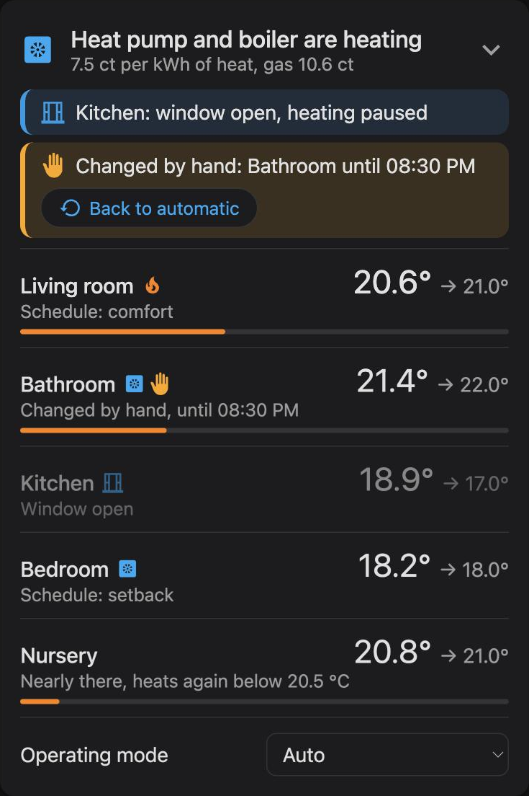
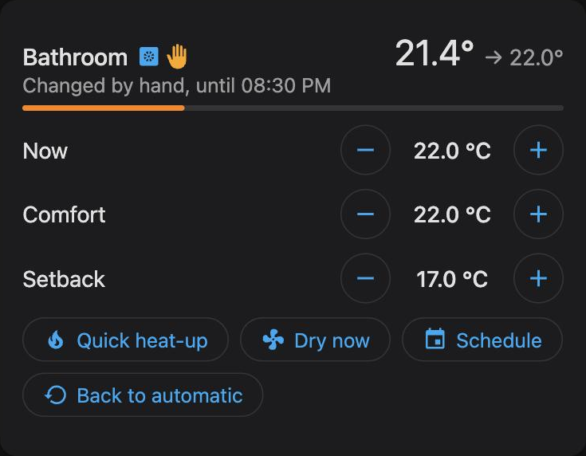

# Thriftherm setup guide

**English** | [Deutsch](../de/EINRICHTUNG.md)

This guide takes you from nothing to a working Thriftherm installation, one step at a time. You do not need to know ebusd or Home Assistant internals, and you only read the steps that fit your heating.

**Nothing is sent to your boiler or thermostats until you switch to *Active* yourself in step 7.** Until then Thriftherm only calculates and shows what it would do, so you can try every step safely.

## Your path

The first question in the setup dialog is "What kind of heating do you have?". It decides which steps you need:

| Your heating | Choose in the dialog | Your steps |
|---|---|---|
| Gas boiler with eBUS (Vaillant, Saunier Duval, Wolf and other eBUS boilers) | *Own gas or oil boiler* | 1, 2, 3, 4, 5, 6, 7, 9 |
| Boiler without eBUS, over OpenTherm or two entities (preview) | *Own gas or oil boiler*, then [4.3a](#43a-a-boiler-without-ebusd-through-entities-preview) | 1, 3, 4, 5, 7, 9 |
| District heating, central heating, heat supplied by the landlord | *Central or district heating, or heat supplied by the landlord* | 1, 3, 4, 5, 7, 9 |
| Only a heat pump or an air conditioner, no boiler | *None – heat pump and room control only* | 1, 3, 4, 5, 7, 9 |

In step 5 you choose for every room how Thriftherm controls it: valves directly, Better Thermostat, Versatile Thermostat or with a sensor only. The dialog leaves out the steps that do not fit by itself.

| Step | What you do | Where |
|---|---|---|
| [1](#1-what-you-need) | Check you have everything | – |
| [2](#2-set-up-ebusd) | Connect Home Assistant to the boiler | ebusd app |
| [3](#3-install-thriftherm) | Install Thriftherm | HACS (Marketplace) |
| [4](#4-add-the-integration) | Walk through the setup dialog | Home Assistant |
| [5](#5-valves-or-thermostats-per-room-optional) | Valves directly or one thermostat per room | Home Assistant, Better Thermostat |
| [6](#6-at-the-boiler) | Set the knob, check the pump mode | at the boiler |
| [7](#7-observe-only-first-then-active) | Watch for a few days, then go active | Home Assistant |
| [8](#8-troubleshooting) | If something does not work | – |
| [9](#9-dashboard) | Put the Thriftherm card on a dashboard | Home Assistant |

## 1. What you need

**For everyone:**

| Item | Needed? | Notes |
|---|---|---|
| Home Assistant 2026.9 or newer | yes | *Settings → About* shows your version. Temperatures in °C (metric unit system): Thriftherm works in °C only and stops the setup otherwise; switched later, it sends no more setpoints (a running heat pump is stopped, a boiler through entities handed back) and shows a repair notice |
| One temperature sensor per room | recommended | any sensor that shows the room temperature in Home Assistant. Without it the valve or thermostat measures at the radiator, less exactly. Something has to measure the room; bathroom drying needs the sensor |
| Window contacts | optional | heating in a room pauses while its window is open |
| Humidity sensors | optional | protection against damp while you are away |
| Smart radiator valves | optional | so that Thriftherm sets the room temperatures: driven directly (preview, no other integration) or through **Better Thermostat** or Versatile Thermostat. Without them the boiler control still works |
| Outdoor temperature sensor | optional | otherwise a weather entity is used |

**Also, with an own gas boiler on eBUS:**

| Item | Needed? | Notes |
|---|---|---|
| Boiler with eBUS | yes | for boiler control |
| eBUS adapter | yes | for example an ebusd adapter shield, connected to the boiler's eBUS terminals |
| MQTT broker | yes | the **Mosquitto broker** app |
| **ebusd** app | yes | reads the boiler and sends it the setpoint |
| Gas meter reading | optional | total volume (m³ or litres) and current flow (m³/h or L/min), if your gas meter is in Home Assistant. A sensor in another unit (kWh, say) is not read |

A boiler without eBUS needs a number entity for the flow and a switch for the heating instead, from an OpenTherm adapter, say ([4.3a](#43a-a-boiler-without-ebusd-through-entities-preview)); a gas meter works there too.

**A central room controller on the eBUS terminal has to go.** If a room controller is already connected to your boiler's eBUS terminal, disconnect it; the eBUS adapter goes on the same terminal. Thriftherm takes over the controller's job, and two controllers on the eBUS would keep overwriting each other's setpoints.

**With a heat pump:** the **heat pump** add-on controls an air conditioner in heating mode, tried on a Midea PortaSplit. You can skip it completely. If you want to use it, it needs the heat pump's climate entity, a smart plug measuring its power, the temperature and humidity of its intake air and the temperature of its outlet air.

### What works with your equipment

The first setup step asks which heating you have. The dialog leaves out the steps that do not apply. The table shows what Thriftherm then does for you.

| Feature | Own boiler on ebusd (core) | + smart valves | + heat pump | Heat pump only, no boiler | Central or district heating¹ |
|---|:-:|:-:|:-:|:-:|:-:|
| **Rooms** | | | | | |
| Room targets from schedules (comfort, setback, schedule helper) | ✓ | ✓ | ✓ | ✓ | ✓ |
| Pre-heating, so the room is warm when the schedule starts | ✓ | ✓ | ✓ | ✓ | ✓ |
| Away mode with pre-heating for your return | ✓ | ✓ | ✓ | ✓ | ✓ |
| Override a room's target for a while | ✓ | ✓ | ✓ | ✓ | ✓ |
| Open window: the room stops calling for heat | ✓ | ✓ | ✓ | ✓ | ✓ |
| Learned heat-up and cool-down rate per room | ✓ | ✓ | ✓ | ✓ | ✓ |
| Targets written to the thermostats; turning one by hand becomes a temporary override | – | ✓ | ✓ | – | ✓ |
| Quick heat-up button per room | – | ✓ | ✓ | ✓ | ✓ |
| Frost protection, also in the mode *Off* | ✓ | ✓ | ✓ | ✓ | ✓ |
| **Boiler** | | | | | |
| Flow temperature from heating curve, room demand and flow/return spread | ✓ | ✓ | ✓ | – | – |
| Heating blocked when no room needs heat; hot water untouched | ✓ | ✓ | ✓ | – | – |
| Learned heating curve correction per room: the room that needs the most sets the flow | ✓ | ✓ | ✓ | – | – |
| Heat-up speed of your choice: more flow for a room that warms up too slowly, learned per room | ✓ | ✓ | ✓ | – | – |
| Hot water recognition: learning pauses after a shower | ✓ | ✓ | ✓ | – | – |
| Heating off over eBUS (mode *Off (frost protection only)*), hot water keeps working | ✓ | ✓ | ✓ | – | – |
| Fallback to the boiler's knob if Home Assistant stops | ✓ | ✓ | ✓ | – | – |
| **Heat pump** | | | | | |
| Heat pump control: slow at a high COP, full power for quick heat-up | – | – | ✓ | ✓ | ✓² |
| COP measured from airflow and air enthalpy; defrost and icing detection | – | – | ✓ | ✓ | ✓² |
| Cost comparison with the central heat source | – | – | ✓ | – | ✓² |
| Bathroom drying | – | – | ✓ | ✓ | ✓² |
| **Always** | | | | | |
| *Observe only* first (Thriftherm works out and shows what it would do, but controls nothing), *Active* only after you release it; a reason for every decision; repair notices | ✓ | ✓ | ✓ | ✓ | ✓ |

✓ works · – not available. Each “+” column includes the columns to its left. In the heat-pump-only column the room rows apply to the rooms the heat pump reaches.

¹ Central or district heating, or heat supplied by the landlord: no own boiler. Rooms are controlled through their valves (directly or through Better Thermostat), and nothing is ever written to the heat supply.

² With the heat pump add-on. The cost comparison then uses the marginal price of district heat, see [With district heating](#with-district-heating).

**Good to know:**

- **A heat pump without a boiler works.** Choose *None – heat pump and room control only* in the first setup step.
- **Bathroom drying needs the heat pump.** It dries with the heat pump's warm air, only in a room the heat pump heats. Details are in the [user guide, heat pump](GUIDE.md#heat-pump-optional).
- **Everything in the boiler rows needs an own boiler on ebusd**, or as a preview a boiler through two entities as with OpenTherm ([step 4.3a](#43a-a-boiler-without-ebusd-through-entities-preview)). That covers flow temperature, heating block, learned heating curve, hot water recognition, heating off over eBUS and the knob fallback (only over ebusd, see 4.3a). With district heating or without a boiler, nothing is ever sent over eBUS.

### With district heating

With district heating, Thriftherm pays off mainly with a heat pump. It then keeps deciding whether heat from electricity or from the district heating is cheaper right now, and lets the heat pump heat only when it pays. Quick heat-up, bathroom drying and learning runs are the exceptions. Without a heat pump, only room control is left: Thriftherm gives the valves (directly or through Better Thermostat) schedules with pre-heating and away mode. That is not much beyond what Better Thermostat with a schedule can already do.

The cost comparison uses the **marginal** price of heat, not the headline one. Under the German Heizkostenverordnung only the consumption share of the building's bill follows your own meter, and of the floor-area share your flat carries its ownership fraction. Saving a kWh therefore saves less than the price per kWh suggests. That *raises* the COP the heat pump has to reach. You set both shares with the prices ([step 4.2](#42-prices)); ignoring them would flatter the heat pump.

## 2. Set up ebusd

Only for a gas boiler with eBUS. Everyone else continues with [step 3](#3-install-thriftherm).

### 2.1 Install the MQTT broker

1. Open *Settings → Apps* and install **Mosquitto broker**. Start it.
2. Home Assistant then offers the **MQTT** integration under *Settings → Devices & services*. Click *Configure* and confirm.

**Check:** *Settings → Devices & services* lists **MQTT**.

### 2.2 Install the ebusd app

1. In *Settings → Apps*, open the app store, then ⋮ → *Repositories* and add `https://github.com/LukasGrebe/ha-addons`.
2. Install **ebusd**. Do not start it yet.

### 2.3 Configure the ebusd app

Open the **Configuration** tab of the ebusd app:

| Setting | What to enter |
|---|---|
| Adapter / device | your eBUS adapter: the USB device, or for a network adapter its address, for example `ens:192.0.2.10:9999` |
| Command-line options | add `--accesslevel=*` – needed so Thriftherm can send the boiler its setpoint. With `--mqttretain` added, all values stay in the broker and are back at once after a restart of Home Assistant – stale ones too, see the note below |
| MQTT | nothing to enter: the app finds Home Assistant's Mosquitto broker by itself. Another broker is given in the command-line options (`--mqtthost=…`, `--mqttport=…`, `--mqttuser=…`, `--mqttpass=…`) |
| Copy `mqtt-hassio.cfg` (`seed_mqtt_cfg`) | on – this puts an editable copy of the MQTT configuration into the app's folder |

Save and start the app.

> **Give fixed addresses.** A network adapter needs a fixed IP address. Create a **DHCP reservation** in your router for the eBUS adapter, and for every other network device Thriftherm reads from, such as a Wi-Fi gas meter. What happens otherwise: [troubleshooting, no data from the boiler](TROUBLESHOOTING.md#repair-notice-no-data-from-the-boiler).
>
> Only *ebusd signal* (`binary_sensor.…_global_signal`) tells whether ebusd really reaches the boiler. When it stays off for more than ten minutes, Thriftherm reports it under Settings → Repairs (*No data from the boiler*). For a push notification, add an automation on that signal, for example "off for 5 minutes".

### 2.4 Show the heating pump and status number

By default ebusd does not send the heating pump (`WP`) and the boiler's status number (`Statenumber`) to Home Assistant. One line changes that:

1. Open `mqtt-hassio.cfg` in the ebusd app's folder (under `addon_configs`, the folder ending in `_ebusd`), for example with the *File editor* or *Studio Code Server* app.
2. Find the line starting with `filter-name` and add `|^wp$|statenumber` to the end of its value (the filter ignores case). Example:

   ```
   filter-name = ...existing value...|^wp$|statenumber
   ```

3. Save and **restart the ebusd app**.

**Check:** after up to ten minutes *Settings → Devices & services → MQTT* shows an ebusd device for your boiler (for example *ebusd bai*) with entities such as **FlowTemp temp**, **ReturnTemp temp**, **WP** and **Statenumber**. `WP` and `Statenumber` can take a few reads to appear.

Is Thriftherm already set up? Then open *Thriftherm → Configure → Gas boiler and gas meter*: the empty fields *Heating pump running (ebusd WP, on/off)* and *Boiler status number (ebusd Statenumber, S.xx)* are filled in with the entities found. Check them and submit.

### 2.5 Poll fewer values so that flow and return are fresher

Optional, for advanced users. ebusd polls the boiler's values in turn; the shorter its list, the more often flow and return come. The control does not need it, Thriftherm fetches its values itself; it helps if you want to see them promptly in a dashboard. What can go, what has to stay and how to trim: [Poll fewer ebusd values](EBUSD.md).

## 3. Install Thriftherm

**With HACS (recommended):** Thriftherm has been in the HACS default list since 2026-10-21. Since Home Assistant 2026.11 HACS is built in and called *Marketplace*; wherever HACS is said here, read *Marketplace* there.

Quickest with this button, it opens Thriftherm in HACS directly; then click *Download* and continue with point 3 of the list below:

[](https://my.home-assistant.io/redirect/hacs_repository/?owner=alpha-uniform&repository=thriftherm&category=integration)

Or by hand:

1. Open **HACS** and search for **Thriftherm**.
2. Open it and click *Download*.
3. Restart Home Assistant (*Settings → System → ⋮ → Restart Home Assistant*).

If you added Thriftherm as a custom repository before, there is nothing to change: it is the same repository, and updates keep coming through HACS.

**By hand:** copy the folder `custom_components/thriftherm` from the repository into `config/custom_components/` of your Home Assistant, then restart.

**Check:** *Settings → Devices & services → Add integration* finds **Thriftherm**.

## 4. Add the integration

Open *Settings → Devices & services → Add integration* and pick **Thriftherm**. The dialog has up to six steps. Everything can be changed later under *Thriftherm → Configure* (the options).

### 4.1 What kind of heating do you have?

| Field | What to choose |
|---|---|
| Kind of heating | **Own gas or oil boiler** for boiler control over ebusd. With *Central or district heating, or heat supplied by the landlord* or *None – heat pump and room control only* the boiler step is left out |

Changed later in the options, the prices for the new kind follow, and for an own boiler the boiler step; nothing is saved before the last step.

### 4.2 Prices

Take the values from your bills. The pre-filled numbers are only examples.

| Field | Where to find it |
|---|---|
| Electricity price | electricity bill, €/kWh |
| Gas price | gas bill, €/kWh |
| Effective boiler efficiency (Hs) | leave the default if unsure |
| Calorific value Hs | gas bill, kWh/m³ |
| State number (Z) | gas bill |

With district heating you see *Heat price from your bill*, *Share billed by consumption* and *Your ownership share of the building* instead.

### 4.3 Gas boiler (ebusd) and gas meter

The step *Gas boiler (ebusd) and gas meter* looks for your ebusd boiler and fills in what it finds: the boiler's values, its ebusd circuit, the eBUS signal and, if exactly one fits, the gas meter. The step's description says what was found, for example *Found: Vaillant (bai), 5 of 5 values — please check.* Check the fields and continue. If nothing was found, it says *No ebusd boiler found — select the entities yourself.*

| Field | What to select or enter |
|---|---|
| Flow temperature | ebusd **FlowTemp temp** |
| Return temperature | ebusd **ReturnTemp temp** |
| Boiler state from Status01 (off/on/overrun/hwc) | ebusd **Status01 pumpstate** (Status01 delivers several entities; the others are temperatures) |
| Heating pump running (ebusd WP, on/off) | ebusd **WP** |
| Boiler status number (ebusd Statenumber, S.xx) | ebusd **Statenumber** |
| Hot water running (binary sensor, optional) | leave empty with ebusd: Thriftherm tells hot water by Status01, the status number and the temperatures. *Status02 hwcmode* is the mode (on, off, auto), not hot water running |
| eBUS signal (binary sensor) | **ebusd's own signal** (`binary_sensor.…_global_signal`), not the adapter's connectivity sensor: when the adapter drops off Wi-Fi, its own sensor keeps its last value "on" |
| Nominal circulation flow of the pump | keep the default unless your boiler's manual says otherwise |
| Gas meter volume (m³, total), Gas meter instantaneous flow (m³/h) | your gas meter entities, if you have them; otherwise leave empty. The control needs no gas meter: it tells burner runs and hot water from the pump and the status code. Without a meter, the *Gas power* and *Gas energy* sensors are not created |
| Without a gas meter: nominal heat input of the boiler (type plate, kW) | only without a gas meter and only for a Vaillant boiler: the value **Q** or **Qn** from the type plate, the larger one of a range (atmoTEC plus VCW 194/4-5: 22.2). With it Thriftherm estimates *Gas for heating* and *Gas for hot water* from the boiler's counters ([how exact](GUIDE.md#dashboard-sensors-worth-knowing)). For that the six ebusd messages PrEnergySumHc1 to 3 and PrEnergySumHwc1 to 3 must reach Home Assistant, so do not exclude them ([Poll fewer ebusd values](EBUSD.md#what-thriftherm-needs)); Thriftherm finds them by itself. Leave empty with a gas meter |
| Power of the heating pump (W, optional) | only with a heat pump: the electricity of the boiler's heating pump then joins the price of boiler heat ([how](GUIDE.md#heat-pump-optional)). A pump in permanent mode often draws 20 to 50 W (type plate or a smart plug). Leave empty to compare gas alone |
| Keep hot water ready (keep-warm of a combi boiler, cylinder loading) | leave it on. Switch it off only on a combi boiler without a cylinder whose keep-warm bothers you at night (about one burner start an hour with no heating demand); it only acts with active boiler control |
| ebusd circuit of the boiler (usually bai) | keep `bai` unless your ebusd device uses another circuit name |
| Heating curve: flow temperature at -10 °C outdoor | start with the default 55 °C |
| Heating curve: flow temperature at +15 °C outdoor | start with the default 30 °C |
| Minimum flow temperature | **about 45 °C for a non-condensing boiler, about 30 °C for a condensing boiler** |
| Maximum flow temperature | 60 °C by default. Better your knob setting from step 6 (for example 55 °C) or a bit lower; higher values have no effect because the knob is the upper limit |
| Condensing boiler | leave on for a condensing boiler, untick for an older boiler without condensing. Limits how far Thriftherm raises the flow at the [boiler's own limit](HOW_IT_WORKS.md#the-boilers-own-limit): up to 55 °C, otherwise up to the maximum |
| Heat-up speed (°C per hour, 0 = off) | start with 0. If a room warms up too slowly after you raise it, set 0.5 to 2; more speed burns more gas ([guide, heat-up speed](GUIDE.md#heat-up-speed)) |
| Share of rooms that must call before the spread judges the curve | keep the default 0.5 |
| Release active boiler control (otherwise observe only) | **leave off for now** – you switch it on in step 7 |

**Why the minimum depends on the boiler type:** a condensing boiler gains from a low flow, but a non-condensing boiler hardly saves anything there, and with short burner runs the heat may not reach distant radiators – see the [user guide, boiler control](GUIDE.md#boiler-control).

The heating curve does not have to be perfect: Thriftherm learns a correction on top, for level and slope each up to ±10 degrees. The form only refuses a curve that is lower at -10 °C than at +15 °C, and a minimum above the maximum.

### 4.3a A boiler without ebusd: through entities (preview)

> **Preview.** Has not run on a real boiler yet – do not rely on it.

A boiler without eBUS can be controlled through two entities that have to exist in Home Assistant already – from an OpenTherm adapter with ESPHome, for example:

| Field | What you choose |
|---|---|
| Without ebusd: flow setpoint of the boiler | a **number entity** that sets the flow temperature |
| Without ebusd: central heating on/off | a **switch** that releases and blocks the heating (hot water is not touched by it) |
| Burner on | optional: binary sensor "flame" or a sensor "burner output" in percent |
| Hot water active | optional: binary sensor "hot water active" |
| Heating pump running | optional: binary sensor "central heating active" |
| Flow temperature | the flow temperature sensor (needed) |

With the number and the switch chosen nothing goes to ebusd any more; the ebusd circuit and *Keep hot water ready* have no effect then. Both are always needed.

One difference to ebusd: an ebusd command runs out after a few minutes and the boiler heats by its knob again. An entity keeps what it was sent. So Thriftherm hands the boiler back itself (heating on) whenever it stops controlling: when switched to *Observe only* and without boiler data with the flow of the heating curve, which then keeps following the outdoor temperature; when Home Assistant stops with the maximum flow, as a knob would stand. If the number or the switch cannot be reached at that moment, a repair notice says so, and Thriftherm hands the boiler back as soon as they are back while Home Assistant runs. Entities Thriftherm never commanded are not touched. If Home Assistant crashes or loses power, the last state stays – a blocked heating included. Check whether your adapter has a timeout of its own for that case.

### 4.4 Heat pump (optional add-on)

This add-on has been tried on a Midea PortaSplit. Without a heat pump: **leave every field empty and click *Submit*.** You can add a heat pump later in the options.

Without a smart plug and sensors at the intake and outlet, Thriftherm cannot measure the COP. Then pick your unit under **COP values of this model** if it is listed (so far the Midea PortaSplit). Thriftherm then decides on values measured on the same model instead of a general curve.

Once a heat pump is set up, *Configure* has the further entry **Heat pump: fine tuning**. It holds the release of the active control, the default heat-up rate of heat pump rooms, what happens when the heat pump alone is not enough, the fan stage in normal operation, minimum run time and minimum pause and, in sections that are folded at first, bathroom drying, COP measurement and defrost. Without a heat pump the entry does not show.

### 4.5 Outdoor conditions

| Field | What to select |
|---|---|
| Outdoor temperature sensors (priority order) | your outdoor sensor(s), best first; leave empty if you have none |
| Outdoor humidity sensor | optional |
| Weather entity (fallback) | your weather entity, for example the one Home Assistant created at installation (often *Forecast Home*) |

Select at least one outdoor sensor or the weather entity – the heating curve needs the outdoor temperature. If the source fails, Thriftherm takes the next one; if all are missing, it keeps the last value for up to six hours. The *Outdoor temperature (selected source)* sensor shows which source is in use.

### 4.6 Rooms

You add one room per page. Tick **Add another room** to get the next page; submit the last room with the tick off to finish.

The fields every room needs stand at the top. Rarer ones lie in three folded sections below: *Heat pump and bathroom drying*, *Comfort windows without a schedule helper, longest preheat* and *Advanced*. Everything is stored as before.

| Field | What to enter |
|---|---|
| Room name | for example `Living room` |
| Room temperature sensor | optional: a sensor of its own in the room measures more exactly than the valve at the radiator. Any temperature sensor in Home Assistant will do. The bathroom drying needs it |
| Room humidity sensor | optional |
| Window / door contacts | optional, all contacts of the room |
| Thermostat or radiator valves | the room's **Better Thermostat**, Versatile or Generic Thermostat, *or* its radiator valves themselves (Zigbee2MQTT, ZHA, Z-Wave, Homematic IP …), which Thriftherm then drives directly (preview, [details](GUIDE.md#valves-driven-directly-without-a-room-thermostat-preview)). Thriftherm sorts them by their integration; the form refuses a room thermostat together with valves. For valves, first enable the valve's *sensor selection* and *external temperature input* in HA if they are disabled (Settings → Devices → Entities), and set its *temperature accuracy* to −0.4. None of these yet? Leave it empty and add it later (options → *Rooms* → room → *Edit*) |
| Weekly schedule helper (optional; replaces the comfort windows under the heading below) | a Home Assistant schedule helper whose blocks are the comfort times |
| Comfort temperature | temperature while the room is in use, for example 20 °C |
| Setback temperature | temperature outside the comfort times, for example 17 °C; never above comfort |
| **Section Comfort windows without a schedule helper, longest preheat** | |
| Comfort windows Mon–Fri / Sat–Sun | times as `HH:MM-HH:MM`, several separated by commas, for example `06:00-08:00,17:00-22:00`. The defaults are 06:00-22:00 and 08:00-23:00 |
| Longest preheat | optional, for a room wanted only briefly ([details](GUIDE.md#pre-heating)) |
| **Section Advanced** | |
| Priority (1 = highest) | rooms that matter most get a lower number; 5 is fine to start |
| Power sensors of internal heat sources | optional, otherwise leave empty: the power of devices that heat the room as well (a computer, say). Above 150 W every further watt lowers the room's heat demand by 0.1 % (*Control parameters → Advanced*: *Internal gain threshold*, *Internal gain demand reduction per W*) |
| Lead at the thermostat | leave it at 0.5 K ([details](GUIDE.md#lead-at-the-thermostat)); 0 switches it off |
| How the valves are controlled | leave it on *Automatic*; only for valves driven directly, the other ways are for testing |

The room is warm *when* a comfort time starts: Thriftherm starts heating early enough.

**Sensors that report only on a change** (e.g. Shelly H&T: only at 1 °C or 1 %): normally an unchanged value holds for 6 hours at most, as long as the device reports nothing else (if it still reports the humidity, say, up to a day). Then switch on **Room sensors report only on a change** under *Options → Control parameters → Advanced*. Room temperatures then hold up to the *Max. sensor age*. With sensors that report every few minutes, leave it off.

Only with a heat pump set up does the form also show the section *Heat pump and bathroom drying* with *Heated by the heat pump*, *Bathroom drying with the heat pump* and *Start the drying by itself after a shower*. Bathroom drying runs on the heat pump, so without one none of the fields appears. With it the room gets the button *Dry now*; with the third switch off, only the button dries. It also needs *Heated by the heat pump* switched on and the room humidity sensor; the form refuses it otherwise.

**Check:** after the last room *Settings → Devices & services* lists **Thriftherm**. Its device shows *Boiler control* and *Room control* set to **Observe only**.

## 5. Valves or thermostats per room (optional)

Skip this if you have no smart radiator valves. The boiler control works without them; open the manual valves far enough and let the flow temperature do the work.

There are three ways per room: the valves directly (no other integration), Better Thermostat or Versatile Thermostat. All go into the field *Thermostat or radiator valves*; Thriftherm sorts them by their integration: Better, Versatile and Generic Thermostat are room thermostats, anything else is a valve. A room has either a room thermostat or valves, not both. What applies day to day: [user guide, room thermostats](GUIDE.md#room-thermostats).

### Valves directly (preview)

In use on Sonoff TRVZB/TRVZBT with Zigbee2MQTT since 2026-11-15; other valves (ZHA, Shelly and more) have only been tested with simulated ones so far.

1. On the valve in Home Assistant, enable the entities *sensor selection* and *external temperature input* if they are disabled (*Settings → Devices → Entities*).
2. On a TRVZB/TRVZBT, set the *temperature accuracy* to −0.4.
3. In Thriftherm, under options → *Rooms* → room → *Edit*, remove a room thermostat from the field *Thermostat or radiator valves* and choose the valves. The form refuses a valve an active Better Thermostat entry still drives.

### Better Thermostat

For each room:

1. Install **Better Thermostat** from HACS (Marketplace), if not done yet.
2. Add one Better Thermostat for the room: select the room's radiator thermostat(s), the **same room temperature sensor** you gave Thriftherm, and the room's **window contacts**.
3. If you give it an outdoor temperature sensor, set the outdoor temperature at which it switches off **high enough, for example 25 °C** – or leave the outdoor sensor empty. Otherwise Better Thermostat blocks heating that Thriftherm asks for.
4. In Thriftherm, select this Better Thermostat in the field *Thermostat or radiator valves* (options → *Rooms* → room → *Edit*), if you left it empty in step 4.6.
5. If turning the knob on a valve is to count as a change by hand, switch **off** the room's **Child lock** switch in Better Thermostat. With it on, Better Thermostat sets the valve back, and the turn does not count.

A thermostat you switch **off** by hand is left alone by Thriftherm, and that room no longer calls the boiler. How Thriftherm deals with the thermostats day to day: [user guide, room thermostats](GUIDE.md#room-thermostats).

### Versatile Thermostat instead of Better Thermostat (preview)

In the field *Thermostat or radiator valves* you can also choose the climate entity of [Versatile Thermostat](https://github.com/jmcollin78/versatile_thermostat). Important when setting it up: Versatile Thermostat's "central boiler" feature stays off while Thriftherm controls the boiler, and you keep the schedule in Thriftherm. What else applies: [user guide, Versatile Thermostat](GUIDE.md#versatile-thermostat-instead-of-better-thermostat-preview).

## 6. At the boiler

Only for a gas boiler with eBUS.

1. **Turn the front knob to the highest flow temperature you want to allow**, for example 55 °C. The knob stays the upper limit, and it is what the boiler falls back to if Home Assistant stops. Do not turn it to the left stop: on a Vaillant atmoTEC that is summer mode and blocks heating whatever Thriftherm sends.
2. **Check the pump mode once.** With the factory setting the pump may stop together with the burner: the boiler cycles all day, but the radiators far down the circuit stay cold. Why this happens: [user guide, pump mode](GUIDE.md#why-the-pump-mode-matters).
   - Vaillant: d.18 = 0 "post-run" is the factory setting – the pump runs only with the burner, plus a short overrun. d.18 = 1 "permanent" – the pump runs while heating is released and stops when Thriftherm blocks heating.
   - Change it in the boiler's service menu, or once via ebusd (message `HcPumpMode`, values `post_run`, `permanent`, `winter`).
   - Check your boiler's manual first; other makes use other codes.

   Thriftherm never writes installer parameters: changing the pump mode is your decision.

## 7. Observe only first, then Active

### 7.1 A few days in "Observe only"

Leave everything in *Observe only* and look at these entities once or twice a day:

| Entity | What to look for |
|---|---|
| *Boiler command* | does *Heat* / *Heating blocked* match what the rooms need? Is the flow temperature plausible? |
| *Thermostat plan* (per room) | the targets it would give each thermostat |
| *Decision reason* | in plain words why Thriftherm does what it does |

If something looks wrong, adjust it in the options before going active.

### 7.2 Going active

1. Only with Better or Versatile Thermostat: switch their entities to **heat**. Valves driven directly need nothing.
2. Thriftherm → *Configure* → **Gas boiler and gas meter**: switch on *Release active boiler control (otherwise observe only)*. Submit.
3. With valves or thermostats: Thriftherm → *Configure* → **Control parameters**, section *Releases*: switch on *Release active room control (write setpoints to the thermostats)*. Submit.
4. With a heat pump: Thriftherm → *Configure* → **Heat pump: fine tuning**: switch on *Release active control (otherwise observe only)*. Submit.

On submitting, Thriftherm switches the released control from *Observe only* to *Active* by itself. You see and switch it under *Settings → Devices & services → Thriftherm → device Thriftherm → Controls*: **Boiler control**, **Room control** and with a heat pump **Heat pump control**. If you later set it to *Observe only* or *Off* by hand, it stays so; if you take the release back, the control goes back to *Observe only*.

**Check after a few minutes:**

| Entity | Expected |
|---|---|
| *Boiler control*, *Room control* | *Active* |
| *Boiler command* | attribute *Commands sent* is on |
| Valves or thermostats | show the new targets from *Thermostat plan* |
| *Safety state* | OK |

**Optional:** for *Away* to end when somebody comes home, choose the people (`person.*`) under Thriftherm → *Configure* → **Control parameters** at *Away ends when one of these people comes home*. Their location in Home Assistant has to be right, for instance through the Companion App.

From now on Thriftherm learns: the heating curve per room in the first one to two weeks of heating season, the heat-up rates after a few days with a setback ([how long what takes](GUIDE.md#how-long-learning-takes)). Everything about daily use – modes, schedules, away mode, learning – is in the [user guide](GUIDE.md).

## 8. Troubleshooting

No ebusd values, a boiler that does not take the setpoint, a thermostat that hangs: what to do then is in [Troubleshooting](TROUBLESHOOTING.md). It is ordered by what you see and also answers frequent questions from daily use.

## 9. Dashboard

### 9.1 The Thriftherm card

Thriftherm brings a card of its own. It comes with the integration, there is nothing else to install. The card finds your rooms by itself.

Each room is a child device of *Thriftherm* named after the room. The card shows that name; rename the device and it shows yours, and if it is called just "Thriftherm", the device's area.



1. Open a dashboard, pencil top right, *Add card*.
2. Type "Thriftherm" in the search and pick the card. The preview already shows your rooms.
3. Optionally in the editor: set a title, hide rooms or change their order, and choose what a tapped room shows (e.g. leave out comfort and setback). Save.

In the YAML editor `type: custom:thriftherm-card` is enough. These are the only other settings:

```yaml
type: custom:thriftherm-card
title: Heating              # optional
hidden_rooms: [arbeitszimmer]  # optional, room keys
hidden_controls: [comfort, setback]  # optional: info, now, comfort, setback, quick_heat_up, dry_now, schedule
room_order: [badezimmer, wohnzimmer]  # optional, the other rooms follow
```

What the card shows, from top to bottom:

- **The heat source in one sentence**, e.g. "Heat pump is heating", below it the cost per kWh of heat. A tap opens the comparison of boiler and heat pump: what each does and why, flow setpoint or COP, cost, the COP from which the heat pump pays off, and what the learning of the heating curve does right now.
- **Notes, only when there are some:** safety restricted, heat pump blocked (only in a mode that uses it, so not in *Central heating only* or *Off (frost protection only)*), window open, frost protection in a room, changed by hand (with *Back to automatic*), heat pump changed by hand, thermostat does not report.
- **One row per room:** measured temperature, target and the reason. If a valve of the room has an opening limit (Sonoff TRVZB/TRVZBT) below 100 %, the row also says how far it is open, e.g. "Valve 60 % open"; with several valves the least. Small icons show whether the boiler or the heat pump heats the room right now, whether it was changed by hand or a window is open. A tap on the room opens an info line (the schedule's next change with the target after it, and the trend once the room's *Temperature trend* sensor is enabled), *Now* (change the target by hand; it holds as long as any change by hand), comfort, setback, *Quick heat-up*, in the bathroom *Dry now*, *Schedule* (opens the room's schedule helper when it has one) and *Back to automatic* while anything by hand is on: a change, *Quick heat-up* or *Dry now*.
- **Operating mode**, in *Away* with the return.

The card needs Home Assistant 2025.1 or newer. Thriftherm adds the card as a dashboard resource itself. If the dashboard still shows *Custom element not found: thriftherm-card* or the old card after installing or updating, hard-reload the page (Cmd+Shift+R or Ctrl+Shift+R). If that does not help, clear the browser's site data for your Home Assistant address; in the app: *Settings → Companion app → Reset frontend cache* ([Troubleshooting](TROUBLESHOOTING.md#the-thriftherm-card-is-missing-custom-element-doesnt-exist)).

### 9.2 The room card

For the page of a single room there is the room card: *Add card → Thriftherm room*, then pick the room in the editor. It shows the room always open, with the same buttons as the big card; the editor chooses which of them appear.



```yaml
type: custom:thriftherm-room-card
room: badezimmer                    # room key
title: Bathroom                     # optional
hidden_controls: [comfort, setback] # optional, as with the big card
header: false                       # optional: no head, only the buttons
```

Without its head (`header: false`, the box *Head* in the editor) the card shows only the buttons: it then fits under a room card of your own that shows temperature and target already.

### 9.3 Example dashboard from standard cards (optional)

If you prefer Home Assistant's standard cards only, a ready-made dashboard is in [`dashboards/thriftherm.en.yaml`](../dashboards/thriftherm.en.yaml) (German labels: [`dashboards/thriftherm.yaml`](../dashboards/thriftherm.yaml)). It shows first what heats now and why.

1. Settings > Dashboards > *Add dashboard* > *New dashboard from scratch*.
2. Open the dashboard, pencil top right, then ⋮ > *Raw configuration editor*. Replace everything with the file's content and save.
3. Adapt the room blocks: the example rooms are `badezimmer` and `wohnzimmer`. Copy one block per room and put in the room key from your entity IDs.
4. Without a heat pump the *Heat pump* view only shows "unavailable". You can delete it.
